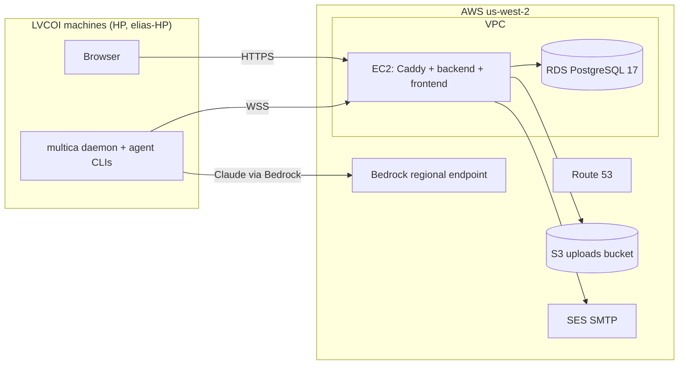

# ADR-001: US hosting for the internal instance of the lvcoi/multica fork

| Field | Value |
|---|---|
| Status | Proposed (needs Lawrence's approval before any spending) |
| Date | 2026-11-06 |
| Author | Platform Architect (LVCO-5) |
| Reviewer | Reviewer-QA |
| Related | LVCO-4 (outside-US dependency audit), LVCO-7 (stand up the instance), LVCO-2 (licensing decision) |

## Scope and licensing boundary

This ADR covers the interim internal instance of the `lvcoi/multica` fork. Under the LVCO-2 decision (2026-11-06) the fork stays under the Multica License: LVCOI internal use only, never hosted for anyone outside LVCOI, with all Multica branding and attribution kept. The issue title says "Multicle instance"; in practice this instance runs the fork, so it is a Multica-branded internal deployment. The clean-room Multicle product is out of scope and gets its own ADRs later.

Every cost below is a proposal. Nothing in this ADR creates an account, buys a domain or starts a paid service.

## Context

### What the stack is

The self-host stack has three server components: a Go backend (REST and WebSocket), a Next.js frontend and PostgreSQL 17 (`SELF_HOSTING.md:7-11`). Each person who runs agents also runs the `multica` CLI and agent daemon on their own machine (`SELF_HOSTING.md:13`). For LVCOI those machines are HP and elias-HP.

`docker-compose.selfhost.yml` wires it up:

- `postgres` uses `pgvector/pgvector:pg17` with a local volume (`docker-compose.selfhost.yml:36-43`). The name is historical: the app needs only `pgcrypto` and `pg_trgm`, and a stock PostgreSQL 17 works (`SELF_HOSTING_ADVANCED.md:375-398`). That makes managed Postgres an option.
- `backend` pulls `ghcr.io/multica-ai/multica-backend:latest` by default (`docker-compose.selfhost.yml:56`). It stores uploads on a local volume (`:62-63`) unless `S3_BUCKET` is set (`server/cmd/server/router.go:417-424`, `server/internal/storage/s3.go:43-46`).
- `frontend` pulls `ghcr.io/multica-ai/multica-web:latest` (`docker-compose.selfhost.yml:235`).
- Both bind to `127.0.0.1` only and expect a TLS reverse proxy in front (`docker-compose.selfhost.yml:3-9`, `:61`, `:239`).
- Migrations run on backend start (`SELF_HOSTING.md:478`).

### Outbound dependencies that matter for hosting

LVCO-4 is the full audit and supersedes this table once it lands. Below are the items that change a hosting decision, each checked against the code.

| Dependency | Where | Default | Classification | Disposition in this ADR |
|---|---|---|---|---|
| Self-host telemetry to `telemetry.multica.ai` | `server/internal/selfhosttelemetry/client.go:10`, cannot be redirected (`SELF_HOSTING.md:17`) | **On**, daily | Unknown location, outside LVCOI control | Off: `DO_NOT_TRACK=1` (`server/internal/selfhosttelemetry/config.go:15-21`) |
| Container images from `ghcr.io/multica-ai` | `docker-compose.selfhost.yml:56,235` | On | US registry (GitHub), but upstream-built binaries | Build from the fork and publish to `ghcr.io/lvcoi` (see Decision) |
| Email via Resend | `server/internal/service/email.go:225-237`; default sender `noreply@multica.ai` (`email.go:114-121`) | Off unless `RESEND_API_KEY` | Third-party relay | Not used; SMTP to Amazon SES in-region instead |
| Google OAuth | `server/internal/handler/auth.go:574-583,587,635` | Off unless `GOOGLE_CLIENT_ID` | US (Google) | Off; email-code login only |
| PostHog | `server/internal/analytics/client.go:72-90` | Off unless `POSTHOG_API_KEY` | Third party | Off: leave key unset, set `ANALYTICS_DISABLED=true` |
| Google Analytics | `apps/web/lib/google-analytics.ts:70`, `docker-compose.selfhost.yml:246` | Off unless `GOOGLE_ANALYTICS_ID` | Third party | Off: leave empty |
| Server LLM layer | `server/pkg/llm/client.go:292,307-309`; OpenAI default host when only a key is set (`:119-122`) | Off | Depends on endpoint | Off for now (see Inference) |
| Lark/Feishu, DingTalk, WeCom | `server/internal/integrations/lark/http_client.go:50`, `dingtalk/client.go:28`, `wecom/wecom_channel.go:40` | Off unless each `*_SECRET_KEY` is set | **Non-US** (mainland China and Chinese-owned services) | Off: never set `MULTICA_LARK_SECRET_KEY`, `MULTICA_DINGTALK_SECRET_KEY`, `MULTICA_WECOM_SECRET_KEY` |
| Qoder Cloud | `server/internal/handler/qoder_catalog.go:20-26` (`api.qoder.com`, `api.qoder.com.cn`) | User-configured connection | Non-US or unknown | Do not configure |
| Telegram, Slack, Composio | `telegram/api.go:26`, `server/pkg/composio/client.go:16` | Off unless secret key set | Third party | Off |
| Browser call to `api.github.com` for release version | `packages/views/runtimes/components/update-section.tsx:15-16` | **On**, no switch | US (GitHub) | Accept for now; follow-up to remove (F-4) |
| Hard-coded `multica.ai` help, docs and download links | `packages/views/layout/help-links.ts:1-7`, `packages/core/runtimes/commands.ts:1-2` | Links, not fetches | Upstream site | Accept; they are attribution-adjacent and must stay under the license |
| Daemon auto-update from GitHub releases | `server/internal/daemon/config.go:682-696` | Off unless the server host is `api.multica.ai` | US (GitHub) | Stays off for this instance |

## Requirements

### Functional

- F1. Run backend, frontend and PostgreSQL for one LVCOI workspace, reachable over HTTPS from HP and elias-HP.
- F2. Email verification codes reach LVCOI users, since email is how users log in (`SELF_HOSTING_ADVANCED.md:31-33`).
- F3. Attachments up to 100 MiB (`SELF_HOSTING_ADVANCED.md:126-133`).
- F4. Daemons on HP and elias-HP connect over WebSocket to the backend.

### Non-functional

- N1. Data residency: database, uploads, backups, logs and email processing all stay in US regions. No runtime call to a server outside the US.
- N2. Security: least privilege, no public signup, TLS everywhere, secrets outside the repo.
- N3. Recovery: point-in-time database restore; RPO of 5 minutes or less and RTO of 4 hours or less are the proposed targets for an internal tool.
- N4. Cost: low two-figure to low three-figure USD per month for hosting, excluding model inference.
- N5. Operability: one person can run it. Upgrades follow upstream with a reviewed PR.

### Integration points

The fork's GitHub repo and GHCR (image source), DNS, the email relay, object storage, managed Postgres, and the agent daemons with their model providers.

## Options considered

### Option A: AWS, one US region, managed services (recommended)

EC2 runs the backend and frontend containers plus Caddy as the TLS proxy. RDS for PostgreSQL 17 holds the database. S3 holds uploads. SES sends mail over SMTP. Route 53 serves DNS. Region: `us-west-2` (Oregon), which is also the code's default `S3_REGION` (`server/internal/storage/s3.go:55-58`). `us-east-1` or `us-east-2` work equally well if Lawrence prefers.

- Pros: Every data store is pinned to one region by configuration. RDS gives automated backups and point-in-time restore without custom scripts. SES plugs into the existing SMTP path with no code change (`email.go:227-237`). The same account can host Bedrock for US inference, with one bill and one IAM model. AWS is a US company.
- Cons: More moving parts than a single VM. Costs more than Option B. Needs an AWS account (spending decision).
- Cost: see the Cost section, roughly $60 to $135 per month.

### Option B: single VM, bundled Postgres

One US VM (Lightsail, or a US-headquartered VPS provider in a US data center) runs the stock compose file: Postgres in a container, uploads on local disk, Caddy in front. Backups are a nightly `pg_dump` plus an uploads tarball copied to object storage in a second US region.

- Pros: Cheapest. Closest to upstream's documented path. Fewest services.
- Cons: Backups and restore are scripts we own and must test. No point-in-time recovery, so RPO is up to 24 hours unless WAL archiving is added. Email still needs a relay; using SES here mixes providers anyway. A disk failure takes database and uploads together.
- Cost: Lightsail lists a 2 vCPU, 4 GB plan at $20 per month ([Lightsail pricing](https://aws.amazon.com/lightsail/pricing)), so roughly $25 to $55 per month with backup storage, DNS and email.

### Option C: Kubernetes with the upstream Helm chart

The repo ships a chart (`deploy/helm/multica`, `SELF_HOSTING.md:182-385`). EKS plus RDS and S3.

- Pros: Scales, matches upstream's production shape.
- Cons: The EKS control plane alone adds a fixed monthly charge on top of everything in Option A, and it is far more to operate than one internal workspace needs. Rejected on simplicity and cost.

## Decision

Adopt **Option A** in `us-west-2`, single-AZ to start, with Multi-AZ RDS as an optional upgrade Lawrence can approve.

### Topology



### Mapping the self-host stack onto AWS

| Compose piece | Becomes | Settings |
|---|---|---|
| `postgres` service (`docker-compose.selfhost.yml:36-53`) | RDS PostgreSQL 17, `db.t4g.small`, gp3 storage, encrypted at rest, not publicly accessible, security group allows 5432 from the EC2 security group only | Remove the `postgres` service and set `DATABASE_URL` to RDS with `sslmode=require` (`SELF_HOSTING_ADVANCED.md:411-421`). The compose file hard-codes `DATABASE_URL` with `sslmode=disable` (`docker-compose.selfhost.yml:65`), so the deploy needs a compose override that replaces it |
| `backend_uploads` volume (`:62-63`) | S3 bucket in `us-west-2`, Block Public Access on, SSE enabled, versioning on | `S3_BUCKET`, `S3_REGION=us-west-2`, `ATTACHMENT_DOWNLOAD_MODE=proxy` or `presign` (`SELF_HOSTING_ADVANCED.md:134-147`). Credentials come from the EC2 instance role through the SDK default chain, so leave `AWS_ACCESS_KEY_ID` and `AWS_SECRET_ACCESS_KEY` empty. Leave all `CLOUDFRONT_*` empty. |
| `backend` image | `ghcr.io/lvcoi/multica-backend:<pinned tag>` | `MULTICA_BACKEND_IMAGE`, `MULTICA_IMAGE_TAG` |
| `frontend` image | `ghcr.io/lvcoi/multica-web:<pinned tag>` | `MULTICA_WEB_IMAGE` |
| Reverse proxy (expected by `docker-compose.selfhost.yml:3-9`) | Caddy container on the same host with automatic TLS | Two hostnames: app and API. Request body limit at least 101 MiB (`SELF_HOSTING_ADVANCED.md:126-133`). `MULTICA_TRUSTED_PROXIES=127.0.0.1/32` (`docker-compose.selfhost.yml:151-155`) |
| Redis (optional, `docker-compose.selfhost.yml:70`) | Not deployed | Unset is supported for a single backend replica |

### Images built from the fork

Nothing runs from `ghcr.io/multica-ai`. The fork's own `release.yml` already publishes to `ghcr.io/${{ github.repository_owner }}` (`.github/workflows/release.yml:147`), so a tag push on `lvcoi/multica` produces `ghcr.io/lvcoi/multica-backend` and `ghcr.io/lvcoi/multica-web`. The Docker jobs need only `GITHUB_TOKEN` (`release.yml:160,277`). The `release` job (Homebrew tap, `release.yml:83-117`) and the `desktop` job (`:403`) target upstream channels and must not run on the fork; see follow-up F-1. Tags use the existing semver rule, which allows a suffix (`release.yml:39`), for example `v0.4.2-lvcoi.1`.

Pin the image tag in `.env`. Never deploy `latest`.

Base images (`golang:1.27.3-alpine`, `alpine:3.21`, `node:22.23.4-alpine` in `Dockerfile:2,27` and `Dockerfile.web:6,29,59`) come from Docker Hub at build time only, on GitHub-hosted runners. That is a build-time dependency, not a runtime one. `pgvector/pgvector` is no longer needed with RDS.

The CLI and daemon on HP and elias-HP should also come from the fork, built with `go build` or the fork's goreleaser config, rather than upstream's GitHub releases (`scripts/install.sh:17-18`). Connect them with `multica setup self-host --server-url https://<api host>` (`server/cmd/multica/cmd_setup.go:27,35`).

### Auth

- Login by email verification code only. Google OAuth stays off: leave `GOOGLE_CLIENT_ID` and `GOOGLE_CLIENT_SECRET` empty (`auth.go:574-583`). The fork has no OIDC or SAML login, so there is no IdP option without code changes.
- `ALLOW_SIGNUP=false`, `ALLOWED_EMAILS=<the LVCOI addresses>`, `WORKSPACE_CREATION_ALLOWED_EMAILS=<Lawrence>` (`SELF_HOSTING_ADVANCED.md:70-80`).
- `JWT_SECRET` from `openssl rand -hex 32`, held in AWS Secrets Manager or SSM Parameter Store and written to `.env` at deploy time; never committed.
- Generate `MULTICA_VCS_SECRET_KEY` only if the self-hosted Git integration is used; leave every chat-integration secret key empty.
- `MULTICA_DEV_VERIFICATION_CODE` stays empty and `APP_ENV=production` (`docker-compose.selfhost.yml:104-105`).

Google, the only third-party login, is US-based and opt-in, so auth replaces no outside-US dependency. Leaving it off removes that dependency entirely.

### Email

SMTP to Amazon SES in `us-west-2`:

```
SMTP_HOST=email-smtp.us-west-2.amazonaws.com
SMTP_PORT=587
SMTP_USERNAME=<SES SMTP credential>
SMTP_PASSWORD=<SES SMTP credential>
SMTP_FROM_EMAIL=noreply@<LVCOI domain>
RESEND_API_KEY=            # empty
```

SMTP wins over Resend when both are set (`email.go:227-237`), and setting `SMTP_FROM_EMAIL` removes the `noreply@multica.ai` default (`email.go:114-125`). SES needs a verified domain identity with DKIM and SPF records in Route 53. A new SES account starts in the sandbox; sending only to verified LVCOI addresses works there, so production access is optional for an internal tool.

This replaces Resend, a third-party relay, and the upstream sender domain.

### DNS and TLS

- Route 53 hosted zone for an LVCOI-owned domain. Which domain is Lawrence's choice; buying one is a spending decision.
- Two A records: `app.<domain>` and `api.<domain>`, pointing at an Elastic IP on the EC2 instance.
- Caddy obtains certificates from Let's Encrypt (US nonprofit). AWS Certificate Manager is the alternative only if an ALB is added later.
- Set `FRONTEND_ORIGIN`, `MULTICA_APP_URL`, `MULTICA_PUBLIC_URL`, `MULTICA_DAEMON_SERVER_URL` and `COOKIE_DOMAIN` to these hostnames.

### Network and security baseline

- EC2 security group inbound: 443 (and 80 for ACME) only. Restrict 443 to LVCOI's known egress IPs if they are stable; otherwise rely on the signup lock. No SSH from the internet: administer through SSM Session Manager.
- RDS and S3 are reachable only from the EC2 role and security group. Add an S3 gateway VPC endpoint so upload traffic never leaves AWS.
- Telemetry and analytics off in `.env`: `DO_NOT_TRACK=1`, `ANALYTICS_DISABLED=true`, `GOOGLE_ANALYTICS_ID=` (empty).
- IMDSv2 required on the instance. EBS and RDS encrypted with AWS-managed keys. CloudTrail on for the account.
- Logs stay on the instance (Docker `local` log driver with rotation) or go to CloudWatch Logs in `us-west-2`.
- Egress domain filtering (an allowlist proxy) is a follow-up, not part of the first deploy. See F-3.

### Inference

The server's own LLM layer stays off (`server/pkg/llm/client.go:292,307-309`). Model traffic comes from the agent CLIs on HP and elias-HP, not from the server.

For Claude, use Amazon Bedrock in the same US region. The admin reference says Bedrock offers regional endpoints with guaranteed data routing (`models-overview.md:58` in Lawrence's Claude Code admin docs), and that on Bedrock, model traffic and authentication go to the provider instead of `api.anthropic.com` (`11-enterprise-network-configuration.md:257`). Configuration for each daemon machine:

- `CLAUDE_CODE_USE_BEDROCK=1`, `AWS_REGION=us-west-2`, credentials from a dedicated IAM user or SSO role limited to `bedrock:InvokeModel*` on the pinned models.
- Pin model IDs with `ANTHROPIC_DEFAULT_OPUS_MODEL` and `ANTHROPIC_DEFAULT_SONNET_MODEL` (`10-enterprise-deployment-overview.md:176`), using regional IDs, not global ones.
- Managed settings `allowedProviders: ["bedrock"]` so a session cannot fall back to the Anthropic API (`10-enterprise-deployment-overview.md:182`).
- `skipWebFetchPreflight: true`, otherwise WebFetch still calls `api.anthropic.com` (`11-enterprise-network-configuration.md:257`).
- `CLAUDE_CODE_DISABLE_NONESSENTIAL_TRAFFIC=1`.

Two gaps for Lawrence:

1. Moving agents from claude.ai sign-in to Bedrock changes billing from subscription to per-token AWS charges. That is a spending decision and is not priced here.
2. Fork Engineer runs on Codex. Where OpenAI processes that traffic is **unknown** from the material available to me; LVCO-4 should classify it.

## Cost

Assumptions: on-demand list prices as found on 2026-11-06 for `us-east-1` (verify `us-west-2` in the AWS Pricing Calculator before approval), 730 hours per month, one workspace with a handful of users, under 50 GB of uploads, under 1,000 emails per month. Model inference is excluded.

| Item | Low | High | Basis |
|---|---|---|---|
| EC2 `t4g.medium` (2 vCPU, 4 GB) | $25 | $50 | $0.0336/h ([source](https://calculator.holori.com/aws/ec2/t4g.medium/us-east-1)); high assumes the next size up |
| EBS gp3 root volume, 30 to 50 GB | $3 | $5 | Estimate, not verified this session |
| RDS PostgreSQL `db.t4g.small` + 20 to 50 GB gp3 | $26 | $55 | $0.032/h, about $23/month ([source](https://www.bytebase.com/dbcost/rds/instance/db.t4g.small/)); high is Multi-AZ, which doubles the instance charge |
| RDS backup storage, cross-region backup copy | $0 | $10 | Backup storage up to the DB size has historically been free; copy to a second US region is optional. Estimate |
| S3 Standard, up to 50 GB, plus versioning | $1 | $3 | $0.023 per GB-month ([source](https://upstash.com/blog/aws-s3-pricing-explained-2026)) |
| SES, under 1,000 emails | $0.10 | $1 | $0.10 per 1,000 ([source](https://aws.amazon.com/ses/pricing/)) |
| Route 53 hosted zone and queries | $1 | $2 | Estimate, not verified this session |
| Public IPv4 address | $4 | $4 | Estimate, not verified this session |
| Data transfer out | $0 | $5 | Small internal traffic. Estimate |
| **Total per month** | **about $60** | **about $135** | |

One-time or yearly: a domain, if LVCOI does not already own one (price depends on registrar and TLD, not quoted here). A one-year Savings Plan or reserved instance would lower EC2 and RDS, but that is a commitment and stays with Lawrence.

Option B for comparison: about $25 to $55 per month, trading away point-in-time restore and managed backups.

## Backup and restore

### Backups

- RDS automated backups, retention 14 days, giving point-in-time restore to any second in that window (meets N3's RPO).
- A manual RDS snapshot before every upgrade, kept until the next upgrade succeeds.
- Optional, if Lawrence approves the cost: automated backup replication to `us-east-2`, so a region-level outage cannot destroy the only copy. It stays in the US.
- S3 versioning on the uploads bucket with a lifecycle rule expiring non-current versions after 30 days. Optional replication to a bucket in `us-east-2`.
- `.env` and the Caddyfile live in SSM Parameter Store or Secrets Manager, so a rebuilt host can recover them.

### Restore procedure

1. Database: RDS "Restore to point in time" into a new instance in `us-west-2`. Wait for it to become available.
2. Stop the backend (`docker compose stop backend`), point `DATABASE_URL` at the restored endpoint, start the backend. The backend runs pending migrations on start (`SELF_HOSTING.md:478`); a restored database is already current, so none should apply.
3. Check `/healthz` returns `{"status":"ok","checks":{"db":"ok","migrations":"ok"}}` (`SELF_HOSTING.md:276-279`).
4. Uploads: restore prior object versions for the affected keys, or copy back from the replica bucket.
5. If the restored database is a clone running alongside the original, clear `instance_telemetry_state` or keep `DO_NOT_TRACK=1` (`SELF_HOSTING.md:23`). With telemetry off this is moot, but keep the step in the runbook.
6. Host loss: launch a new instance from the same launch template, pull `.env` from Parameter Store, `docker compose up -d`, move the Elastic IP.

Test a full restore into a scratch RDS instance once before go-live and then quarterly. Record the measured RTO on the issue.

## Upgrade and upstream sync

1. Fork Engineer fetches `multica-ai/multica` `main` (or a release tag) into a branch on `lvcoi/multica` and opens one PR per sync. The PR description lists upstream migrations in the range and any new env vars or outbound hosts.
2. Reviewer-QA reviews. Any new outbound host is checked against LVCO-4's classification before merge. Lawrence merges.
3. Tag the merge commit `vX.Y.Z-lvcoi.N`. The fork's release workflow builds and pushes both images to `ghcr.io/lvcoi`.
4. Before deploy: take a manual RDS snapshot.
5. Deploy: set `MULTICA_IMAGE_TAG` to the new tag, `docker compose pull && docker compose up -d` (`SELF_HOSTING.md:471-478`). Migrations run on backend start.
6. Verify `/healthz`, log in, open an issue, and confirm both daemons reconnect.
7. Rollback: set the previous tag. If the new release ran a migration that the old binary cannot read, restore the pre-upgrade snapshot (data written after the snapshot is lost, so keep the deploy window short).
8. Read upstream's release notes for one-off ordering rules, such as the `v0.3.4` to `v0.3.5+` backfill (`SELF_HOSTING.md:481`).

Cadence: sync monthly, or sooner for security fixes.

## Consequences

### Positive

- Database, uploads, backups, logs and mail all sit in one US region of a US provider.
- The two default-on outbound calls in the stock stack (telemetry, upstream images) are gone.
- Restore uses managed point-in-time recovery instead of scripts we would have to maintain.
- Inference and hosting can share one AWS account and one US region.

### Negative

- AWS lock-in for the database and mail. Both use standard protocols (Postgres, SMTP, S3 API), so moving later is work but not a rewrite.
- About $60 to $135 per month, against roughly $25 to $55 for a single VM.
- The fork must keep a working release workflow and a sync process; drift from upstream is now our cost.
- Browser calls to `api.github.com` remain until F-4 lands.

### Risks

- An upstream sync adds a new default-on outbound call. Mitigation: the sync PR checklist in step 1 and Reviewer-QA's check against LVCO-4.
- Someone sets a chat-integration key for a non-US service. Mitigation: the deploy runbook lists those variables as must-stay-empty, and F-3 blocks the hosts at egress.

## Follow-ups for Fork Engineer (LVCO-7)

These need code or a running system to prove, so they are listed here rather than built by Platform Architect.

- F-1. Make the fork's `release.yml` publish only the Docker images and Helm chart on fork tags; skip the Homebrew `release` job and the `desktop` job (or gate them on `github.repository_owner == 'multica-ai'`). Confirm `ghcr.io/lvcoi/multica-backend` and `-web` appear after a test tag.
- F-2. Prove the stack against RDS with `sslmode=require` and against S3 using only the instance role, with `ATTACHMENT_DOWNLOAD_MODE=proxy`. Record any env var that turned out to be required.
- F-3. Experiment: an egress allowlist proxy on the host (backend `HTTPS_PROXY` pointing at it), allowing only the SES SMTP host, S3 and the GitHub API, and confirm the backend still works. Report whether it is worth keeping.
- F-4. Remove or gate the browser-side `api.github.com` calls (`packages/views/runtimes/components/update-section.tsx:15-16`, `apps/web/features/landing/utils/use-github-stars.ts:31`) behind a server config flag, and confirm Next.js does not fetch Google Fonts at runtime (`apps/web/app/layout.tsx:3`).
- F-5. Configure one daemon machine for Claude on Bedrock in `us-west-2` as described under Inference, and confirm with `/status` that the provider is Bedrock and that no traffic goes to `api.anthropic.com`.

## Decisions for Lawrence

1. Approve Option A (about $60 to $135 per month), or choose Option B (about $25 to $55).
2. Approve opening an AWS account (or using an existing one) and the region, proposed `us-west-2`.
3. Pick the domain for `app.` and `api.` hostnames, and whether to buy one.
4. Whether to pay for Multi-AZ RDS and cross-region backup copies.
5. Whether to move agent inference to Bedrock, which turns model usage into per-token AWS charges.
