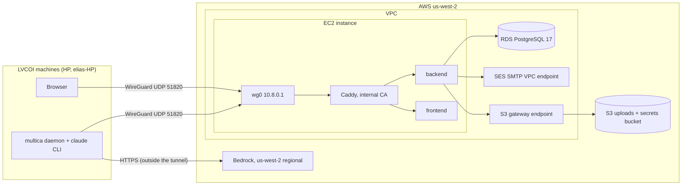

# ADR-001: US hosting for the internal instance of the lvcoi/multica fork

| Field | Value |
|---|---|
| Status | Proposed (needs Lawrence's approval before any spending) |
| Date | 2026-11-06 (revision 2, after Reviewer-QA review on PR #1) |
| Author | Platform Architect (LVCO-5) |
| Reviewer | Reviewer-QA |
| Related | LVCO-4 audit (`docs/multicle/outside-us-dependencies.md`, PR #2), LVCO-7 (stand up the instance), LVCO-2 (licensing decision) |

## Scope and licensing boundary

This ADR covers the interim internal instance of the `lvcoi/multica` fork. Under the LVCO-2 decision (2026-11-06) the fork stays under the Multica License: LVCOI internal use only, never hosted for anyone outside LVCOI, with all Multica branding and attribution kept. The issue title says "Multicle instance"; in practice this instance runs the fork, so it is a Multica-branded internal deployment. The clean-room Multicle product is out of scope.

LVCO-7's acceptance says the instance must not be reachable by anyone outside LVCOI. This ADR treats that as a network requirement, not a login requirement.

Every cost below is a proposal. Nothing in this ADR creates an account, buys a domain or starts a paid service.

## Context

### What the stack is

The self-host stack has three server components: a Go backend (REST and WebSocket), a Next.js frontend and PostgreSQL 17 (`SELF_HOSTING.md:7-11`). Each person who runs agents also runs the `multica` CLI and agent daemon on their own machine (`SELF_HOSTING.md:13`). For LVCOI those machines are HP and elias-HP.

`docker-compose.selfhost.yml` wires it up:

- `postgres` uses `pgvector/pgvector:pg17` with a local volume (`docker-compose.selfhost.yml:36-43`). The app needs only `pgcrypto` and `pg_trgm`, and a stock PostgreSQL 17 works (`SELF_HOSTING_ADVANCED.md:375-398`), so managed Postgres is an option.
- `backend` pulls `ghcr.io/multica-ai/multica-backend:latest` by default (`docker-compose.selfhost.yml:56`) and waits for `postgres` to be healthy (`:57-59`). It hard-codes `DATABASE_URL` to the bundled database with `sslmode=disable` (`:65`). Uploads go to a local volume (`:62-63`) unless `S3_BUCKET` is set (`server/cmd/server/router.go:417-424`).
- `frontend` pulls `ghcr.io/multica-ai/multica-web:latest` (`:235`).
- Both bind to `127.0.0.1` and expect a TLS reverse proxy in front (`:3-9`, `:61`, `:239`).
- `docker-compose.yml` is a different file that defines only a development `postgres` (`docker-compose.yml:1-16`). A bare `docker compose` command in the repo root selects it, not the self-host file.
- Migrations run on backend start (`SELF_HOSTING.md:478`).

### What the LVCO-4 audit found

The audit (PR #2) is the source of truth for classification. The rows that drive this ADR:

| Audit row | Finding | Class (audit) | How this ADR answers it |
|---|---|---|---|
| S1 | Daily telemetry to `telemetry.multica.ai` (`server/internal/selfhosttelemetry/client.go:11`). The only server call made with no configuration | US `us-west-2`, third party (Index Labs) | `DO_NOT_TRACK=1`, and egress to it is blocked |
| S3-S6 | Lark/Feishu, DingTalk, WeCom, Qoder | Non-US | Keys unset, and egress blocked |
| S7 | Telegram | Non-US | Key unset, and egress blocked |
| S9, S10, S19 | Skill imports (`clawhub.ai`, skills.sh, GitHub), user-supplied MCP, plugin and Git endpoints. Triggered by users, no off switch | Unknown or depends on value | Egress blocked. These features fail closed on this instance |
| S12, C7, C8 | PostHog, Google Analytics | US or unknown, third party | Keys unset, `ANALYTICS_DISABLED=true` passed through the override |
| S13 | Resend | Unknown (edge) | Not used. SES over SMTP through a VPC endpoint |
| B1 | Default images from `ghcr.io/multica-ai` | Upstream | Images built from the fork |
| D1, D2 | `multica update` and daemon auto-update pull upstream releases | Upstream | `MULTICA_DAEMON_AUTO_UPDATE=false`; `multica update` is not used |
| D3 | CLI `multica setup` defaults to Multica Cloud | US, third party | Only `multica setup self-host` against our host |
| D5 | The daemon runs any agent CLI on `PATH`; `qoderclicn`, `dsh`, `kimi` are non-US, the rest unknown | Mixed | Daemon-host policy below |
| C1-C3 | Desktop app defaults to Multica Cloud and auto-updates from upstream | Upstream | Desktop app not used for this instance; browser only |
| C4, C9 | Browser fetches `api.github.com` for release version and stars (`packages/views/runtimes/components/update-section.tsx:15-16`) | Unknown (edge) | Accepted: no user data sent. Removed by audit follow-up F3 |
| C5, C10 | Mobile build and Chinese docs page (Bilibili) | Upstream / non-US | Mobile not used; `DOCS_URL` left empty |

## Requirements

### Functional

- F1. Run backend, frontend and PostgreSQL for one LVCOI workspace, reachable over HTTPS from HP and elias-HP only.
- F2. Email verification codes reach LVCOI users (`SELF_HOSTING_ADVANCED.md:31-33`).
- F3. Attachments up to 100 MiB (`SELF_HOSTING_ADVANCED.md:126-133`).
- F4. Daemons on HP and elias-HP connect over WebSocket; realtime updates work in the browser.

### Non-functional

- N1. Data residency: database, uploads, backups, logs and email processing stay in US regions. No runtime call from the server to anything outside the US. Agent model traffic from daemon hosts goes to a US region.
- N2. Not reachable from outside LVCOI (LVCO-7). Least privilege, TLS everywhere, secrets outside the repo.
- N3. Recovery: RPO of 5 minutes or less and RTO of 4 hours or less, proposed for an internal tool.
- N4. Hosting cost in the low two figures to low three figures USD per month, excluding model inference.
- N5. One person can run it. Upgrades follow upstream through a reviewed PR.

### Integration points

GitHub and GHCR (image source, maintenance window only), the email relay, object storage, managed Postgres, the WireGuard tunnel to LVCOI machines, and the agent daemons with their model providers.

## Options considered

### Option A: AWS, one US region, managed data services, private access (recommended)

One EC2 instance runs Caddy, the backend and the frontend. RDS for PostgreSQL 17 holds the database, S3 holds uploads and SES sends mail. Access is only through a WireGuard interface on the instance. Region `us-west-2`, which is also the code's default `S3_REGION` (`server/internal/storage/s3.go:55-58`).

- Pros: Every data store is pinned to one region by configuration. RDS gives point-in-time restore without scripts. SES fits the existing SMTP path with no code change (`server/internal/service/email.go:227-237`). Security groups give egress control a process cannot bypass. The same account can serve Bedrock for US inference.
- Cons: More moving parts than one VM. Needs an AWS account (spending decision).
- Cost: about $65 to $145 per month (Cost section).

### Option B: single VM, bundled Postgres

One US VM (Lightsail, or another US provider) runs the stock compose file with Postgres in a container, uploads on local disk, nightly `pg_dump` and an uploads tarball copied to a second US region.

- Pros: Cheapest and closest to upstream's documented path.
- Cons: Backup and restore scripts are ours to write and test. RPO up to 24 hours without WAL archiving. Lightsail has no VPC endpoints, so egress control means a host firewall, which a root process can change. One disk failure takes database and uploads together.
- Cost: Lightsail lists 2 vCPU, 4 GB at $20 per month ([Lightsail pricing](https://aws.amazon.com/lightsail/pricing)); about $25 to $55 per month in total.

### Option C: EKS with the upstream Helm chart

`deploy/helm/multica` (`SELF_HOSTING.md:182-385`) on EKS plus RDS and S3.

- Pros: Matches upstream's production shape and scales.
- Cons: The EKS control plane is a fixed monthly charge on top of Option A, and far more to run than one internal workspace needs. Rejected.

## Decision

Adopt **Option A** in `us-west-2`, single-AZ to start.

### Topology



### Access: private network only

Nothing on the instance listens on the public internet except WireGuard.

- EC2 security group inbound: UDP 51820 only. No TCP 22, 80 or 443 from the internet. If HP and elias-HP have stable egress IPs, restrict UDP 51820 to them as well. Whether they do is unknown; Lawrence to confirm (decision 2).
- WireGuard (kernel module, `wg-quick@wg0`) on the instance with interface address `10.8.0.1/24`. One peer per LVCOI device, each with its own key. No third-party coordination service is involved.
- Administration is SSH over the tunnel only (`10.8.0.1:22`), key-based. AWS Systems Manager is not used, because it needs outbound access to the SSM API.
- Names: `app.multica.lvcoi.internal` and `api.multica.lvcoi.internal`, mapped to `10.8.0.1` in each client's hosts file. `.internal` is reserved for private use, so no public DNS record or domain is needed for the app itself.
- Consequence: GitHub App webhooks, autopilot webhooks and anything else that needs inbound calls from the internet do not work. `MULTICA_PUBLIC_URL`, `GITHUB_APP_*` and `GITHUB_WEBHOOK_SECRET` stay empty.

The alternative is a security-group allowlist of LVCOI's public IPs on TCP 443. It is simpler but only works if those IPs are stable, and it needs a publicly trusted certificate (see TLS). The login wall alone (`ALLOW_SIGNUP=false`) is not an option here, because it leaves the app reachable from anywhere.

### TLS

Caddy issues certificates from its own internal CA (`local_certs`). No ACME, no public CA, no outbound call. That also removes the Let's Encrypt and ZeroSSL fallback question for this layout.

- Copy Caddy's root certificate (`/data/caddy/pki/authorities/local/root.crt` in the `caddy_data` volume) into the Windows certificate store on HP and elias-HP. Browsers using the OS store and the Go-built daemon then trust it. Firefox needs its own import.
- Back up the `caddy_data` volume with the secrets bundle, so a rebuilt host keeps the same root.

If Lawrence chooses the IP-allowlist alternative, use a public CA with DNS-01 and pin the issuer explicitly in the Caddyfile (`cert_issuer acme { dir https://acme-v02.api.letsencrypt.org/directory }`). F-2 then confirms that issued certificates come from Let's Encrypt only.

### Browser layout: single origin

The browser uses only `app.`. `api.` serves daemons and the CLI. This follows the upstream "Same Origin (Recommended)" layout (`SELF_HOSTING_ADVANCED.md:651-667`) and keeps the session cookie host-only.

Caddyfile:

```
{
	local_certs
	skip_install_trust
}

app.multica.lvcoi.internal {
	request_body {
		max_size 101MB
	}
	handle /ws {
		reverse_proxy backend:8080
	}
	handle {
		reverse_proxy frontend:3000
	}
}

api.multica.lvcoi.internal {
	request_body {
		max_size 101MB
	}
	reverse_proxy backend:8080
}
```

The `/ws` route goes straight to the backend because the docs say WebSockets do not pass through the Next.js rewrites (`SELF_HOSTING_ADVANCED.md:667`). The code does have a `/ws` rewrite (`apps/web/next.config.ts:78`, `apps/web/config/runtime-urls.ts:134`); the direct route works either way. F-2 tests realtime.

### Deploy files

The host runs the stock `docker-compose.selfhost.yml` plus one override, `docker-compose.lvcoi.yml`, kept in the deploy directory on the host. `.env` sets `COMPOSE_FILE`, so every bare `docker compose` command in that directory uses both files.

`docker-compose.lvcoi.yml`:

```yaml
services:
  postgres:
    profiles: ["local-db"]   # never started; RDS replaces it
  backend:
    depends_on: !reset {}
    environment:
      DATABASE_URL: ${DATABASE_URL:?set DATABASE_URL to the RDS endpoint}
      ANALYTICS_DISABLED: "true"
  caddy:
    image: caddy@sha256:<pinned digest>
    depends_on: [backend, frontend]
    ports:
      - "10.8.0.1:443:443"
    volumes:
      - ./Caddyfile:/etc/caddy/Caddyfile:ro
      - caddy_data:/data
    networks:
      default:
        ipv4_address: 172.30.0.10
    restart: unless-stopped
networks:
  default:
    ipam:
      config:
        - subnet: 172.30.0.0/24
volumes:
  caddy_data:
```

- `profiles` keeps `postgres` from starting, and `!reset {}` clears the `depends_on` that would otherwise require it (`docker-compose.selfhost.yml:57-59`). `!reset` needs Docker Compose 2.24 or later. F-2 confirms `docker compose config` shows no `postgres` dependency.
- `DATABASE_URL` is replaced because the base file hard-codes it (`docker-compose.selfhost.yml:65`).
- `ANALYTICS_DISABLED` is set here because the base file does not pass it through. Analytics would stay off anyway, since `POSTHOG_API_KEY` is not passed either (`server/internal/analytics/client.go:72-76`).
- Caddy binds only to the WireGuard address. The `wg-quick@wg0` unit must start before Docker, or the bind fails.

`.env` (values in angle brackets come from the secrets bundle):

```dotenv
COMPOSE_FILE=docker-compose.selfhost.yml:docker-compose.lvcoi.yml

# Images
MULTICA_BACKEND_IMAGE=ghcr.io/lvcoi/multica-backend
MULTICA_WEB_IMAGE=ghcr.io/lvcoi/multica-web
MULTICA_IMAGE_TAG=<vX.Y.Z-lvcoi.N>

# Database and storage
DATABASE_URL=postgres://<user>:<password>@<rds-endpoint>:5432/multica?sslmode=require
S3_BUCKET=<uploads bucket>
S3_REGION=us-west-2
ATTACHMENT_DOWNLOAD_MODE=proxy
AWS_ACCESS_KEY_ID=
AWS_SECRET_ACCESS_KEY=

# URLs and cookies (single origin)
FRONTEND_ORIGIN=https://app.multica.lvcoi.internal
MULTICA_APP_URL=https://app.multica.lvcoi.internal
CORS_ALLOWED_ORIGINS=https://app.multica.lvcoi.internal
COOKIE_DOMAIN=
NEXT_PUBLIC_API_URL=
NEXT_PUBLIC_WS_URL=
REMOTE_API_URL=http://backend:8080
MULTICA_DAEMON_SERVER_URL=https://api.multica.lvcoi.internal
MULTICA_PUBLIC_URL=
MULTICA_TRUSTED_PROXIES=172.30.0.10/32
DOCS_URL=

# Auth
JWT_SECRET=<openssl rand -hex 32>
APP_ENV=production
MULTICA_DEV_VERIFICATION_CODE=
ALLOW_SIGNUP=false
ALLOWED_EMAILS=<LVCOI addresses>
WORKSPACE_CREATION_ALLOWED_EMAILS=<Lawrence>
GOOGLE_CLIENT_ID=
GOOGLE_CLIENT_SECRET=

# Email (SES through the VPC endpoint)
SMTP_HOST=email-smtp.us-west-2.amazonaws.com
SMTP_PORT=587
SMTP_USERNAME=<SES SMTP credential>
SMTP_PASSWORD=<SES SMTP credential>
SMTP_FROM_EMAIL=noreply@<LVCOI domain>
RESEND_API_KEY=

# Off: telemetry, analytics, cloud, integrations, server LLM
DO_NOT_TRACK=1
GOOGLE_ANALYTICS_ID=
MULTICA_CLOUD_URL=
MULTICA_LARK_SECRET_KEY=
MULTICA_DINGTALK_SECRET_KEY=
MULTICA_WECOM_SECRET_KEY=
MULTICA_TELEGRAM_SECRET_KEY=
MULTICA_SLACK_SECRET_KEY=
MULTICA_LLM_API_KEY=
MULTICA_LLM_BASE_URL=
GITHUB_APP_ID=
GITHUB_APP_PRIVATE_KEY=
GITHUB_WEBHOOK_SECRET=
```

Notes on these values:

- `COOKIE_DOMAIN` stays empty. In the single-origin layout cookies are host-only on `app.`, which is correct (`SELF_HOSTING_ADVANCED.md:172-180`). Setting it to a hostname breaks login or every write.
- `MULTICA_TRUSTED_PROXIES` is Caddy's fixed address on the compose network. The backend sees that address as the peer, so forwarded headers from Caddy are trusted and nothing else is. The same list feeds the webhook limiter (`server/internal/handler/autopilot_webhook.go:951`) and the auth rate limiters (`server/cmd/server/router.go:1572-1573`). `127.0.0.1/32` would have no effect, because the backend is in a container and never sees a loopback peer.
- `ATTACHMENT_DOWNLOAD_MODE=proxy` keeps downloads on the instance, so the browser never talks to S3 (`SELF_HOSTING_ADVANCED.md:134-147`).
- `.env` is mode 600 and owned by root.

### Mapping the self-host stack onto AWS

| Compose piece | Becomes |
|---|---|
| `postgres` | RDS PostgreSQL 17, `db.t4g.small`, gp3, encrypted, not publicly accessible. Security group allows 5432 from the EC2 security group only |
| `backend_uploads` volume | S3 bucket in `us-west-2`: Block Public Access on, SSE-S3, versioning on, bucket policy allowing only the instance role. Reached through an S3 gateway endpoint |
| Instance role credentials | EC2 instance profile limited to the uploads bucket and the secrets bucket. IMDSv2 required with `HttpPutResponseHopLimit=2`, because the backend reads credentials from inside a container. With a hop limit of 1, the backend boots and `/healthz` passes, and uploads fail only when someone attaches a file (`server/internal/storage/s3.go:72` loads config without resolving credentials) |
| Reverse proxy | Caddy service in the override, internal CA, bound to `10.8.0.1` |
| Redis | Not deployed. Unset is supported for a single backend replica (`docker-compose.selfhost.yml:70`) |

### Egress control, enforced from the first deploy

Egress is enforced by the EC2 security group, which no process on the instance can change.

Allowed outbound from the instance in normal operation:

| Destination | Port | Why |
|---|---|---|
| RDS security group | TCP 5432 | Database |
| S3 managed prefix list (`com.amazonaws.us-west-2.s3`) through the gateway endpoint | TCP 443 | Uploads and secrets bucket |
| SES SMTP interface endpoint security group | TCP 587 | Email. With private DNS on the endpoint, `email-smtp.us-west-2.amazonaws.com` resolves to it |
| WireGuard peers | UDP (replies only) | Security groups are stateful; no rule needed |

Not subject to security groups and therefore always available: the VPC DNS resolver, the instance metadata service and Amazon Time Sync.

Everything else is denied, including `telemetry.multica.ai`, `api.github.com`, `clawhub.ai`, skills.sh, the chat-integration hosts, model APIs and any user-supplied MCP or plugin endpoint. That covers audit rows S9, S10 and S19, which have no configuration switch.

This works for mail where a proxy would not. The backend dials SMTP directly (`server/internal/service/email.go:142`) and ignores `HTTPS_PROXY`, so the rule must be at the network layer.

**Maintenance window.** Image pulls (`ghcr.io`, `pkg-containers.githubusercontent.com`), the Caddy image from Docker Hub and OS package updates need general outbound 443. For each maintenance window, the operator attaches a second security group, `maintenance-egress` (TCP 443 to `0.0.0.0/0`), and detaches it afterwards. CloudTrail records both actions.

Features that stop working because of this, by design: skill import from registries and GitHub, the GitHub App integration, Slack and Composio, remote MCP servers called by the server, and the server LLM layer.

### Images built from the fork

Nothing runs from `ghcr.io/multica-ai`. A tag push on `lvcoi/multica` runs the image jobs in `release.yml`, which publish to `ghcr.io/${{ github.repository_owner }}` (`.github/workflows/release.yml:147`). The Homebrew `release` job and `helm-chart` are already skipped on forks (`release.yml:90`, `:359`), and `desktop` depends on `release` (`:404`), so a fork tag produces only the two images. Tags follow the existing rule, which allows a suffix (`release.yml:39`), for example `v0.4.2-lvcoi.1`. Always deploy a pinned tag, never `latest`.

**Pull access.** `lvcoi/multica` is a public repository. Recommendation: make the two image packages public too, so the instance pulls with no credential. The images contain only what the public source builds; secrets come from `.env` at runtime. If Lawrence makes the repository private, make the packages private and store a classic personal access token with only `read:packages` in the secrets bundle for `docker login ghcr.io`. Package visibility is a GitHub setting, so it is Lawrence's call (decision 7).

Base images (`Dockerfile:2,27`, `Dockerfile.web:6,29,59`) come from Docker Hub at build time on GitHub-hosted runners. That is a build-time dependency only.

### Auth

- Email verification code only. Google OAuth stays off. The fork has no OIDC or SAML login (`server/cmd/server/router.go:1574-1577`).
- Signup closed to an allowlist, and workspace creation limited to Lawrence (`SELF_HOSTING_ADVANCED.md:70-80`).
- `JWT_SECRET` generated once and kept in the secrets bundle.

These sit behind the network control above. They are a second layer, not the access control.

### Email

SES in `us-west-2` over SMTP, reached through the SES SMTP interface endpoint. SMTP wins over Resend (`email.go:227-237`), and `SMTP_FROM_EMAIL` replaces the `noreply@multica.ai` default (`email.go:114-125`).

SES needs a verified sender. A domain identity needs DKIM records wherever that domain's DNS is hosted. A new SES account starts in the sandbox, where sending to verified addresses works; that is enough for a handful of LVCOI users.

If Lawrence does not want to buy or use a domain, the fallback is no mail at all: with no SMTP or Resend configured, codes are printed to the backend log (`SELF_HOSTING_ADVANCED.md:58`), and the operator reads them over SSH. That fits two or three users, and it removes SES and its endpoint from the cost.

### Secrets

The secrets bundle holds `.env`, the Caddyfile, the WireGuard server key and peer list, a `caddy_data` backup and the SES SMTP credential. It lives as one object in a separate S3 bucket (SSE-S3, versioning on, access for the instance role and Lawrence only) and in one offline copy Lawrence keeps. Secrets Manager and Parameter Store are not used, because they would need another endpoint or outbound access.

### Clients and daemon hosts

**Browser only.** For this instance, LVCOI uses the web app in a browser over the tunnel. The desktop app is not installed for it. The packaged desktop app defaults to Multica Cloud unless `~/.multica/desktop.json` exists, and it auto-updates from upstream releases (audit C1, C2). If Lawrence later wants it, each install needs:

```json
{ "schemaVersion": 1, "apiUrl": "https://api.multica.lvcoi.internal", "appUrl": "https://app.multica.lvcoi.internal" }
```

at `~/.multica/desktop.json` (`apps/desktop/src/main/runtime-config-loader.ts:26-44`, `apps/desktop/src/shared/runtime-config.ts:53-83`), and auto-update turned off in the app. It would still be an upstream build until audit follow-ups F1 and F3 land. Mobile is not used (audit C5).

**CLI and daemon.**

- Build `multica` from the fork (`go build ./server/cmd/multica`), not from upstream releases or the Homebrew tap (audit D2).
- Connect with `multica setup self-host --profile lvcoi --server-url https://api.multica.lvcoi.internal` (`server/cmd/multica/cmd_setup.go:27,35`).
- Set `MULTICA_DAEMON_AUTO_UPDATE=false` for that profile. It is already off for a non-cloud server (`server/internal/daemon/config.go:600-607`), and setting it makes that explicit.
- Never run `multica update` on these hosts. It pulls upstream releases (audit D1).

**Agent CLI policy.** The daemon launches any supported CLI it finds on `PATH` (`server/internal/daemon/config.go:266-270`). The policy for any daemon connected to this instance:

| CLI | Allowed | Why |
|---|---|---|
| `claude` | Yes | Configured for Bedrock `us-west-2` as below |
| `codex` | Pending decision 4 | US processing is possible but not confirmed for LVCOI's plan |
| `qoderclicn`, `dsh`, `kimi` | Never | Non-US vendors (audit D5) |
| All others | No | Region unknown (audit D5) |

HP and elias-HP may also run daemons for other workspaces with other CLIs installed. The instance's daemon therefore runs with a `PATH` containing only `git`, the allowed CLIs and system directories. The Runtimes page should then list only allowed CLIs; F-5 checks this. Audit follow-up F6 (`MULTICA_ALLOWED_AGENTS`) replaces the `PATH` rule with a real allowlist.

**Codex.** OpenAI documents US data residency that covers the Codex app and CLI, with authentication, routing and analytics possibly processed outside the region ([OpenAI help article 9903489](https://help.openai.com/en/articles/9903489)). Whether LVCOI's OpenAI plan qualifies is unknown. Two options for Lawrence:

1. Confirm an OpenAI plan with US data residency and enable it. Then `codex` is allowed, with the caveat that routing and authentication may leave the US.
2. Keep `codex` off this instance's daemons and run Fork Engineer's work for this instance on `claude` through Bedrock.

Recommendation: option 2 until option 1 is confirmed in writing, because only option 2 meets N1 with the facts in hand.

### Inference

The server's LLM layer stays off (`server/pkg/llm/client.go:292,307-309`). Model traffic comes from agent CLIs on the daemon hosts and goes over their normal internet connection, not through the tunnel.

Provider comparison (all pay-as-you-go through the cloud account, regions chosen by the customer: `10-enterprise-deployment-overview.md:60-80` in Lawrence's Claude Code admin docs):

| Provider | For this instance |
|---|---|
| Amazon Bedrock | Recommended. Same AWS account and region as the hosting, one IAM model, one bill. Regional endpoints guarantee data routing (`models-overview.md:58`) |
| Google Cloud's Agent Platform | Works, with regional endpoints (`models-overview.md:59`). Adds a second cloud account |
| Microsoft Foundry | Works in chosen Azure regions. Adds a second cloud account |

Claude Code settings on each daemon host, as managed settings:

- `CLAUDE_CODE_USE_BEDROCK=1`, `AWS_REGION=us-west-2`, credentials from a dedicated IAM principal allowed only `bedrock:InvokeModel*` on the pinned models.
- Pin regional (not global) model IDs with `ANTHROPIC_DEFAULT_OPUS_MODEL` and `ANTHROPIC_DEFAULT_SONNET_MODEL` (`10-enterprise-deployment-overview.md:176`).
- `allowedProviders: ["bedrock"]` (`10-enterprise-deployment-overview.md:182`).
- `skipWebFetchPreflight: true`, or WebFetch still calls `api.anthropic.com` (`11-enterprise-network-configuration.md:257`).
- `CLAUDE_CODE_DISABLE_NONESSENTIAL_TRAFFIC=1`.

**Inference cost basis.** List prices per million tokens: Opus 5.5 $4 input and $20 output, Sonnet 5.5 $2 and $10 (`models-overview.md:32`). Cache reads cost 5% of the input price on both (`models-overview.md:49`). Bedrock regional endpoints carry a 10% premium over global ones ([Claude on Amazon Bedrock](https://platform.claude.com/docs/en/build-with-claude/claude-on-amazon-bedrock)), so about $4.40 and $22 for Opus, $2.20 and $11 for Sonnet.

Worked example. Assume one agent run reads 500k input tokens, 90% of them cache reads, and writes 50k output tokens. This is an assumption, not a measurement, and it ignores cache-write charges.

| Model (regional) | Uncached input | Cache reads | Output | Per run |
|---|---|---|---|---|
| Opus 5.5 | 50k × $4.40/M = $0.22 | 450k × $0.22/M = $0.10 | 50k × $22/M = $1.10 | about $1.42 |
| Sonnet 5.5 | 50k × $2.20/M = $0.11 | 450k × $0.11/M = $0.05 | 50k × $11/M = $0.55 | about $0.71 |

At 200 runs a month that is about $140 to $285; at 1,000 runs, about $710 to $1,420. Measure a week of real runs on Bedrock before committing to a budget.

## Cost (hosting)

Assumptions: on-demand list prices found on 2026-11-06 for `us-east-1` (check `us-west-2` in the AWS Pricing Calculator before approval), 730 hours per month, a handful of users, under 50 GB of uploads, under 1,000 emails per month. Inference is excluded; see above.

| Item | Low | High | Basis |
|---|---|---|---|
| EC2 `t4g.medium` (2 vCPU, 4 GB) | $25 | $50 | $0.0336/h ([source](https://calculator.holori.com/aws/ec2/t4g.medium/us-east-1)); high is the next size up |
| EBS gp3 root volume, 30 to 50 GB | $3 | $5 | Estimate, not verified |
| RDS PostgreSQL `db.t4g.small` + 20 to 50 GB gp3 | $26 | $55 | $0.032/h, about $23/month ([source](https://www.bytebase.com/dbcost/rds/instance/db.t4g.small/)); high is Multi-AZ |
| RDS backup storage and optional cross-region copy | $0 | $10 | Estimate |
| S3 Standard, up to 50 GB, versioned | $1 | $3 | $0.023 per GB-month ([source](https://upstash.com/blog/aws-s3-pricing-explained-2026)) |
| SES, under 1,000 emails | $0.10 | $1 | $0.10 per 1,000 ([source](https://aws.amazon.com/ses/pricing/)) |
| SES SMTP interface endpoint, one AZ | $7 | $8 | Estimate, not verified. $0 with the log-only mail fallback |
| S3 gateway endpoint | $0 | $0 | Gateway endpoints carry no hourly charge. Not verified this session |
| Public IPv4 (Elastic IP for WireGuard) | $4 | $4 | Estimate, not verified |
| Data transfer out | $0 | $5 | Estimate |
| **Total per month** | **about $65** | **about $145** | |

A domain, if LVCOI does not already own one, is only needed for SES. Savings Plans or reserved instances would lower EC2 and RDS but are a commitment, so they stay with Lawrence.

## Backup and restore

### Backups

- RDS automated backups with 14-day retention, giving point-in-time restore (meets N3's RPO).
- A manual RDS snapshot before every upgrade, kept until the next upgrade succeeds.
- Optional, if Lawrence approves the cost: automated backup replication to `us-east-2`.
- S3 versioning on the uploads bucket; non-current versions expire after 30 days. Optional replication to `us-east-2`.
- The secrets bundle, versioned in its bucket and copied offline.

### Restore procedure (database)

All commands run in the deploy directory, where `.env` sets `COMPOSE_FILE`.

1. In RDS, "Restore to point in time" into a new instance in `us-west-2`, in the same subnet group and security group. Wait until it is available.
2. Edit `DATABASE_URL` in `.env` to the new endpoint.
3. Recreate the backend so it reads the new value: `docker compose up -d --force-recreate backend`. `docker compose start` or `restart` would keep the old environment and silently stay on the original database.
4. Confirm the running container uses the restored host: `docker compose exec backend sh -c 'echo "$DATABASE_URL" | sed "s/:[^:@]*@/:***@/"'`.
5. Check `/healthz` returns `{"status":"ok","checks":{"db":"ok","migrations":"ok"}}` (`SELF_HOSTING.md:276-279`). This proves only that a database answers, so also open an issue created before the restore point and confirm one created after it is absent.
6. When satisfied, delete or rename the old RDS instance so nothing points at it by mistake.

### Restore procedure (uploads and host)

- Uploads: restore prior object versions for affected keys, or copy back from the replica bucket.
- Host loss: launch a new instance from the launch template with the same security groups, attach `maintenance-egress`, install Docker and WireGuard, fetch the secrets bundle from S3, restore `/etc/wireguard`, `.env`, the Caddyfile and the `caddy_data` volume, run `docker compose pull` and `docker compose up -d`, move the Elastic IP, then detach `maintenance-egress`.
- If a restored database clone runs beside the original, keep `DO_NOT_TRACK=1` or clear `instance_telemetry_state` (`SELF_HOSTING.md:23`).

Test a full restore into a scratch RDS instance before go-live and then quarterly. Record the measured RTO on the issue.

## Upgrade and upstream sync

1. Fork Engineer merges `multica-ai/multica` (`main` or a release tag) into a branch on `lvcoi/multica` and opens one PR per sync. The PR lists upstream migrations in the range, new env vars and any new outbound host or CLI.
2. Reviewer-QA reviews. Any new outbound host is classified against the LVCO-4 audit, and any new env var defaulting to on is added to the override or `.env`. Lawrence merges.
3. Tag `vX.Y.Z-lvcoi.N`. The fork's release workflow pushes both images to `ghcr.io/lvcoi`.
4. Take a manual RDS snapshot.
5. Attach `maintenance-egress`.
6. Set `MULTICA_IMAGE_TAG` in `.env`, then `docker compose pull` and `docker compose up -d`. Migrations run on backend start (`SELF_HOSTING.md:478`).
7. Detach `maintenance-egress`.
8. Verify `/healthz`, log in, create an issue, watch it update live in a second browser tab, and confirm both daemons reconnect.
9. Rollback: set the previous tag and `docker compose up -d`. If the new release ran a migration the old binary cannot read, restore the pre-upgrade snapshot using the procedure above. Data written after the snapshot is lost, so keep the window short.
10. Check upstream release notes for one-off ordering rules, such as the `v0.3.4` to `v0.3.5+` backfill (`SELF_HOSTING.md:481`).

Cadence: monthly, or sooner for security fixes.

## Consequences

### Positive

- Database, uploads, backups, logs and mail sit in one US region of a US provider.
- The instance is unreachable from the internet except for the WireGuard port, which meets LVCO-7's access criterion at the network layer.
- Outbound traffic is denied by default at a layer the instance cannot change. A missed setting or an audit gap fails closed.
- No public certificate authority, DNS provider or VPN service is in the runtime path.

### Negative

- About $65 to $145 per month, against about $25 to $55 for a single VM.
- Every LVCOI device needs a WireGuard peer, a hosts-file entry and the internal root certificate.
- GitHub App, webhooks, skill import from registries, Slack, Composio, remote MCP on the server and the server LLM layer are unavailable.
- The fork must keep a working release workflow and a sync process.
- Browser calls to `api.github.com` (audit C4, C9) remain until audit follow-up F3 lands. They leave from the user's machine, not the instance.

### Risks

- An upstream sync adds a default-on outbound call. Mitigations: sync PR checklist (step 2), and the egress deny rule makes it fail instead of leak.
- Someone installs a non-allowed agent CLI on a daemon host. Mitigation: the restricted `PATH` and the F-5 check, then audit follow-up F6. This is a policy control until F6 lands.
- `maintenance-egress` is left attached. Mitigation: step 7 of the upgrade, and an optional alarm when that group stays attached for more than two hours.

## Follow-ups for Fork Engineer (LVCO-7)

These need a running system to prove, so they are written for Fork Engineer rather than built here.

- F-1. Push a test tag on the fork and confirm `ghcr.io/lvcoi/multica-backend` and `ghcr.io/lvcoi/multica-web` appear, and that no Homebrew, Helm or desktop job ran. Report the packages' visibility.
- F-2. Stand up the stack as written. Confirm:
  - `docker compose config` shows no `postgres` service dependency and no started `postgres`.
  - The backend reaches RDS with `sslmode=require`.
  - An attachment upload and download work using only the instance role, with `HttpPutResponseHopLimit=2`.
  - Realtime works: an issue edited in one tab updates in another, and the browser's WebSocket goes to `app.` `/ws`.
  - Login and a write (create an issue) work with `COOKIE_DOMAIN` empty.
  - Caddy serves certificates from its internal CA and makes no outbound connection.
- F-3. From inside the backend container, with `maintenance-egress` detached, confirm `telemetry.multica.ai`, `api.github.com` and `clawhub.ai` time out, and that RDS, S3 and SES SMTP work. Send one verification email through the SES endpoint.
- F-4. Measure restore: run the database restore procedure against a scratch RDS instance and record the time taken.
- F-5. Configure one daemon host: profile `lvcoi`, restricted `PATH`, Claude on Bedrock `us-west-2` as above. Confirm the Runtimes page lists only allowed CLIs and that `/status` in Claude Code shows Bedrock as the provider.

## Decisions for Lawrence

1. Approve Option A (about $65 to $145 per month), or choose Option B (about $25 to $55).
2. Access: approve WireGuard-only access (recommended), or an IP allowlist on 443 if HP and elias-HP have stable public IPs. Please confirm whether they do.
3. AWS account and region: proposed `us-west-2`.
4. Codex: confirm an OpenAI plan with US data residency, or keep `codex` off this instance's daemons (recommended until confirmed).
5. Inference: move this instance's agents to Bedrock. Per-token charges as estimated above.
6. Email: SES with an LVCOI-owned domain (which one, and whether to buy it), or the log-only fallback with no mail.
7. GHCR package visibility: public (recommended, matches the public repository) or private with a read-only token.
8. Optional spending: Multi-AZ RDS and cross-region backup copies.
