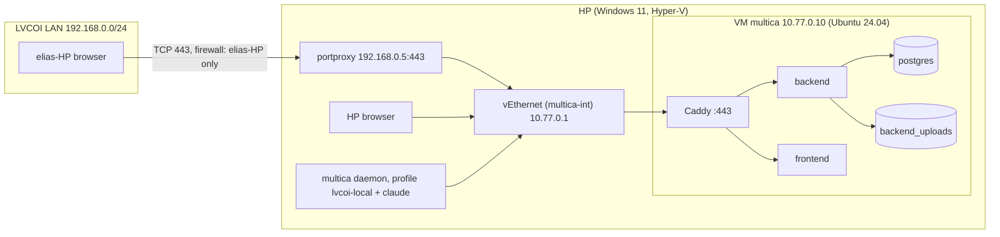

# ADR-002: local VM hosting for the interim internal instance of the lvcoi/multica fork

| Field | Value |
|---|---|
| Status | Proposed |
| Date | 2026-11-07 |
| Author | Platform Architect (LVCO-10) |
| Reviewer | Reviewer-QA |
| Supersedes | The hosting choice in [ADR-001](adr-001-us-hosting.md), for now. ADR-001 stays on file as the plan for a later move to AWS |
| Related | LVCO-4 audit ([outside-us-dependencies.md](outside-us-dependencies.md)), LVCO-7 (build the VM), LVCO-2 (licensing) |

## Scope and licensing boundary

Lawrence decided on 2026-11-07 not to use AWS yet (LVCO-10, LVCO-7). This ADR puts the interim internal instance of the `lvcoi/multica` fork on a virtual machine on HP. The fork stays under the Multica License: LVCOI internal use only, never reachable by anyone outside LVCOI, all Multica branding and attribution kept. The clean-room Multicle product is out of scope.

Nothing in this ADR spends money. Every step uses software already on HP or free downloads.

## Context

### The host

Facts about HP, from LVCO-10 and checked again on 2026-11-07 for this ADR:

| Fact | Value | How checked |
|---|---|---|
| OS | Windows 11 Pro | LVCO-10 |
| Hyper-V | Already enabled: `vmms` service running, `Default Switch` present | `Get-Service vmms`, `Get-VMSwitch` |
| Lawrence's account | Member of `BUILTIN\Hyper-V Administrators`. Agent sessions are not elevated | `whoami /groups`; `WindowsPrincipal.IsInRole(Administrator)` returned `False` |
| Memory | 15.7 GB visible, **3.1 GB free** at the time of the check, with this workspace's daemon and two `claude` sessions running | `Win32_OperatingSystem.FreePhysicalMemory` |
| CPU | 8 logical CPUs | LVCO-10 |
| Disk | One volume, `C:`, 136 GB free. No second disk | LVCO-10, `Get-PSDrive` |
| LAN | HP is on Wi-Fi at `192.168.0.5/24`, network profile `Private` | `Get-NetIPAddress`, `Get-NetConnectionProfile` |
| Not installed | Docker, VirtualBox | LVCO-10 |
| Installed | `go`, `claude`, and `codex` (under `AppData\Local\pnpm\bin`) | `Get-Command`, `command -v` |
| Running daemon | This workspace's daemon, profile `desktop-api.multica.ai`, server `https://api.multica.ai` | `multica daemon status` |

The free-memory figure was measured once. It is the main constraint on sizing.

### The stack

As in ADR-001: Go backend, Next.js frontend and PostgreSQL 17, wired by `docker-compose.selfhost.yml`. The parts that matter here:

- `postgres` runs `pgvector/pgvector:pg17` with a named volume (`docker-compose.selfhost.yml:36-43`). The backend's `DATABASE_URL` points at it (`:65`).
- Uploads go to the `backend_uploads` volume (`:62-63`) when `S3_BUCKET` is unset: the server tries S3 first and falls back to local storage (`server/cmd/server/router.go:415-424`). Local storage writes each file under `./data/uploads/<key>` (`server/internal/storage/local.go:45-49,154-156`) with a `.meta` sidecar holding the filename and content type (`local.go:165-170`).
- Backend and frontend publish only on `127.0.0.1` and expect a TLS proxy in front (`docker-compose.selfhost.yml:3-9,61,239`).
- Session cookies carry the `Secure` flag when `FRONTEND_ORIGIN` is `https://` (`server/internal/auth/cookie.go:169-176`), so the browser must reach the app over HTTPS.

### What each AWS service becomes

| ADR-001 (AWS) | ADR-002 (local VM) |
|---|---|
| EC2 app host | Hyper-V Generation 2 VM `multica` on HP, Ubuntu 24.04 LTS Server |
| RDS PostgreSQL 17 | The compose file's own `postgres` container, volume on the VM disk |
| S3 uploads bucket | The compose file's `backend_uploads` volume, local storage |
| SES over SMTP | No mail provider. Login codes are read from the backend log (see Login without mail) |
| Security groups for egress | A Hyper-V internal switch with no NAT and no route off HP |
| WireGuard | Not needed. HP reaches the VM directly; elias-HP reaches it through a port proxy on HP |
| RDS backups and snapshots | Nightly `pg_dump` and uploads archive, copied to HP; Hyper-V checkpoints |
| Dedicated daemon host with Bedrock | A second daemon profile on HP, using HP's existing `claude` sign-in |
| CloudTrail | Not available. Hyper-V event logs on HP record VM and network-adapter changes |

## Requirements

### Functional

- F1. Run backend, frontend and PostgreSQL for one LVCOI workspace, reachable over HTTPS from HP and, if Lawrence chooses, from elias-HP on the LAN.
- F2. LVCOI users can log in without a mail provider.
- F3. Attachments up to 100 MiB (`SELF_HOSTING_ADVANCED.md:126-133`).
- F4. An agent daemon connects over WebSocket and runs one agent task end to end (LVCO-7 acceptance).

### Non-functional

- N1. Data residency: database, uploads, backups and logs stay on LVCOI machines in the US. The server makes no runtime call to anything outside the US. Every non-US item from the LVCO-4 audit is off.
- N2. Not reachable from the internet (LVCO-7). Outbound traffic from the VM is blocked by default, at a layer the VM cannot change.
- N3. Leaves HP enough memory for this workspace's daemon and agents.
- N4. Recovery: RPO of 24 hours and RTO of 4 hours, proposed for an interim internal tool. ADR-001's 5-minute RPO relied on RDS point-in-time restore, which a local VM does not have.
- N5. No spending. Steps that need Windows administrator rights are single commands Lawrence can run.

### Integration points

The browser on HP and elias-HP, the agent daemon on HP, GitHub Container Registry and Ubuntu's package archive (maintenance window only), and the off-disk backup target.

## Options considered

### Option A: Hyper-V VM on an internal switch with no NAT (recommended)

One Ubuntu VM on a new internal switch, `multica-int`. HP's side of the switch is `10.77.0.1`; the VM is `10.77.0.10`. No NAT is created for that subnet, and Windows does not route between interfaces by default, so the VM has no path off HP. elias-HP reaches the app through a TCP port proxy on HP, limited by Windows Firewall to elias-HP's address.

- Pros: Egress is impossible by construction and enforced outside the guest. A process with root inside the VM cannot add a route that leads anywhere. Fixed addresses survive reboots. Uses only Hyper-V, which is already enabled.
- Cons: Three one-time administrator commands on HP (host address, hosts entry, root certificate), plus two more for LAN access. Image pulls and OS updates need a temporary second network adapter.
- Cost: none.

### Option B: Hyper-V VM on the built-in Default Switch, firewall inside the guest

Attach the VM to `Default Switch`, which already gives NAT to the internet, and block outbound traffic with `ufw` inside Ubuntu.

- Pros: No administrator commands for networking. Updates work any time.
- Cons: The egress block lives inside the guest, where root can change it. `ufw default deny outgoing` filters the guest's own `OUTPUT` chain, but Docker routes container traffic through `FORWARD` and its own NAT rules, so the containers (the backend included) would still reach the internet unless rules are also added to Docker's `DOCKER-USER` chain. One missed rule fails open. `Default Switch` also hands out addresses by DHCP from a range Windows can change when HP restarts, so hosts-file entries break.
- Cost: none. Rejected, because it does not meet N2 by enforcement.

### Option C: WSL2 with Docker Engine

Run the compose stack in a WSL2 distribution.

- Pros: No VM to manage, lighter on memory.
- Cons: WSL2 runs as Lawrence's Windows user with `C:` mounted at `/mnt/c`, so the stack is not isolated from HP's files. Its default NAT gives full outbound access, and closing it takes more configuration than Option A. A snapshot means `wsl --export` with the distribution stopped. Rejected.

Docker Desktop is not considered: it is not installed, it also runs on WSL2, and this ADR has not checked whether LVCOI qualifies for its free tier. VirtualBox is not installed and would run on top of Hyper-V's hypervisor with no benefit.

## Decision

Adopt **Option A**: a Hyper-V Generation 2 VM running Ubuntu 24.04 LTS Server on an internal switch with no NAT. Run this instance's agent daemon on HP as a second daemon profile.

### Topology



No arrow leaves the VM. The daemon's model traffic leaves from HP, not from the VM (see Agents and inference).

### VM size

| Resource | Setting | Why |
|---|---|---|
| vCPU | 2 of 8 | A handful of users. Leaves 6 logical CPUs for HP's agents |
| Memory | Dynamic: startup 2048 MB, minimum 1536 MB, maximum 3072 MB | HP had 3.1 GB free with its agents running. A fixed 4 GB VM would push HP into paging. Dynamic memory gives back what the VM does not use |
| Disk | One dynamically expanding VHDX, 60 GB maximum | Starts at a few GB. Leaves at least 76 GB of the 136 GB free on `C:` for checkpoints, the local backup copies and HP's own use |
| Generation | 2, Secure Boot on with the `MicrosoftUEFICertificateAuthority` template | Required for Ubuntu on a Generation 2 VM |
| Checkpoints | Type `Production`, automatic checkpoints off | Checkpoints are taken by hand before changes (see Snapshot and roll back the VM) |
| Start and stop | `AutomaticStartAction Start`, `AutomaticStopAction ShutDown` | The VM comes back after a Windows Update restart and shuts down cleanly first |

The 3072 MB cap is an estimate for Postgres, the Go backend, the Next.js server and Caddy with a few users. F-2 records the VM's real peak; raise the cap only if HP has the headroom.

The instance is down whenever HP is off or asleep. For an interim tool used from HP, that is accepted.

### Network

**Addresses.** Internal switch `multica-int`. HP `10.77.0.1/24`, VM `10.77.0.10/24`. This subnet does not overlap the LAN (`192.168.0.0/24`), `Default Switch` (`172.27.0.0/20` at the time of the check) or the compose network below (`172.30.0.0/24`).

**Egress.** The VM's adapter on `multica-int` has an address, no gateway and no DNS server. No `New-NetNat` is created for `10.77.0.0/24`, so even if root in the guest adds a default route through `10.77.0.1`, HP drops the packets. Name lookups for `telemetry.multica.ai`, `api.github.com`, `clawhub.ai`, `api.qoder.com` or anything else fail at once. This covers the audit rows that have no configuration switch (S6's `POST /qoder/environments`, S9, S10, S19).

Do not enable IP routing on HP (`IPEnableRouter` stays `0`), and never add a NAT for `10.77.0.0/24`. Either would undo this control.

**Time.** With no route to an NTP server, the guest keeps time through Hyper-V's Time Synchronization integration service, which is on by default.

**Who can reach the VM.**

- HP reaches `10.77.0.10` directly over the internal switch.
- elias-HP (optional, decision 2) reaches `https://app.multica.lvcoi.internal` at HP's LAN address. `netsh interface portproxy` on HP listens on `192.168.0.5:443` and forwards to `10.77.0.10:443`. A Windows Firewall rule allows TCP 443 on that address from elias-HP's LAN address only. TLS passes through the proxy untouched. The IP Helper service (`iphlpsvc`), which portproxy needs, is running and set to Automatic on HP.
- Nothing is reachable from the internet: the VM has no public address, the port proxy listens only on the LAN address, and the firewall rule admits one LAN host. Whether the home router forwards any port to HP was not checked; it must not forward 443.
- HP's address and elias-HP's address must both stay fixed for the proxy and the firewall rule. If the router hands them out by DHCP, give each a reservation on the router (decision 2).

Why not an external switch on HP's Wi-Fi: the VM would sit on the LAN with the router as its gateway, which brings back internet egress, and bridging a Hyper-V external switch over Wi-Fi is less reliable than over Ethernet.

**Inside the guest.** `ufw` with `default deny incoming`, allowing TCP 22 and 443 from `10.77.0.1` only. This is a second layer. Docker publishes Caddy's port through its own rules, so the switch, not `ufw`, is the control for 443.

**On HP.** The `vEthernet (multica-int)` adapter will likely be classed as an unidentified network with the `Public` profile, which blocks unsolicited inbound traffic from the VM to HP. F-2 confirms the profile.

**Guest netplan** (`/etc/netplan/60-multica.yaml`), with static MAC addresses set on both Hyper-V adapters so the match is stable:

```yaml
network:
  version: 2
  ethernets:
    int0:
      match: { macaddress: "00:15:5d:77:00:10" }
      set-name: int0
      addresses: [10.77.0.10/24]
      dhcp4: false
      # No routes and no nameservers: nothing leaves HP.
    maint0:
      match: { macaddress: "00:15:5d:77:00:99" }
      set-name: maint0
      dhcp4: true
      optional: true
```

`maint0` exists only during a maintenance window (below).

**Maintenance window.** Image pulls and `apt` upgrades need the internet. For each window, the operator hot-adds a second adapter on `Default Switch`, runs `sudo netplan apply` in the guest, does the work, then removes the adapter. Both cmdlets run without elevation for a member of Hyper-V Administrators:

```powershell
Add-VMNetworkAdapter -VMName multica -SwitchName "Default Switch" -Name maint -StaticMacAddress 00155D770099
# ... pull, upgrade ...
Remove-VMNetworkAdapter -VMName multica -Name maint
```

Hyper-V's event logs on HP record adapter changes. F-2 confirms that hot-add works on this VM, and F-3 that the backend can no longer reach `telemetry.multica.ai` once `maint` is removed.

### Names and TLS

Same hostnames as ADR-001, so a later move to AWS changes only where they point: `app.multica.lvcoi.internal` (browser) and `api.multica.lvcoi.internal` (daemon and CLI).

| Machine | Hosts entry |
|---|---|
| HP | `10.77.0.10 app.multica.lvcoi.internal api.multica.lvcoi.internal` |
| elias-HP | `192.168.0.5 app.multica.lvcoi.internal api.multica.lvcoi.internal` |

TLS follows ADR-001's "TLS" section without change: Lawrence creates an offline root constrained to `.multica.lvcoi.internal` and one leaf for the two names, and keeps the root key offline. Caddy gets only the leaf. HP imports the root into the machine's Trusted Root store (an administrator step below). elias-HP imports it with `update-ca-certificates` and into the NSS database for Chrome, as ADR-001 describes. The `multica` daemon on HP is a Go program, and Go on Windows verifies certificates through the Windows certificate store, so the machine-store import covers it.

Caddy's internal CA is not used, for ADR-001's reason: it would keep an unconstrained root key on the VM.

### Deploy files on the VM

The deploy directory is `/opt/multica`, owned by root. It holds the fork's `docker-compose.selfhost.yml`, one override, the Caddyfile, `tls/` and `.env`. `.env` sets `COMPOSE_FILE`, so every bare `docker compose` command there uses both files.

`docker-compose.lvcoi.yml`:

```yaml
services:
  backend:
    environment:
      ANALYTICS_DISABLED: "true"
  caddy:
    image: caddy@sha256:<pinned digest>
    depends_on: [backend, frontend]
    ports:
      - "10.77.0.10:443:443"
    volumes:
      - ./Caddyfile:/etc/caddy/Caddyfile:ro
      - ./tls:/etc/caddy/tls:ro
      - caddy_data:/data
    networks:
      default:
        ipv4_address: 172.30.0.10
    restart: unless-stopped
networks:
  default:
    ipam:
      config:
        - subnet: 172.30.0.0/24
volumes:
  caddy_data:
```

- Unlike ADR-001, `postgres` stays on and `DATABASE_URL` keeps the base file's value. No `!reset` is needed, so the override does not depend on a minimum Compose version.
- `ANALYTICS_DISABLED` is passed here because the base file does not pass it.
- The Caddyfile is ADR-001's, unchanged: `app.` sends `/ws` to the backend and everything else to the frontend, `api.` sends everything to the backend, and both carry `request_body max_size 101MiB`.

`.env` (values in angle brackets are generated once and kept in the secrets copy):

```dotenv
COMPOSE_FILE=docker-compose.selfhost.yml:docker-compose.lvcoi.yml

# Images built from the fork, pinned
MULTICA_BACKEND_IMAGE=ghcr.io/lvcoi/multica-backend
MULTICA_WEB_IMAGE=ghcr.io/lvcoi/multica-web
MULTICA_IMAGE_TAG=<vX.Y.Z-lvcoi.N>

# Bundled database
POSTGRES_DB=multica
POSTGRES_USER=multica
POSTGRES_PASSWORD=<openssl rand -hex 24>

# Local uploads (S3 off)
S3_BUCKET=
ATTACHMENT_DOWNLOAD_MODE=proxy

# URLs and cookies (single origin)
FRONTEND_ORIGIN=https://app.multica.lvcoi.internal
MULTICA_APP_URL=https://app.multica.lvcoi.internal
CORS_ALLOWED_ORIGINS=https://app.multica.lvcoi.internal
COOKIE_DOMAIN=
NEXT_PUBLIC_API_URL=
NEXT_PUBLIC_WS_URL=
REMOTE_API_URL=http://backend:8080
MULTICA_PUBLIC_URL=
MULTICA_TRUSTED_PROXIES=172.30.0.10/32
DOCS_URL=

# Auth
JWT_SECRET=<openssl rand -hex 32>
APP_ENV=production
MULTICA_DEV_VERIFICATION_CODE=
ALLOW_SIGNUP=false
ALLOWED_EMAILS=<LVCOI addresses>
WORKSPACE_CREATION_ALLOWED_EMAILS=<Lawrence>
GOOGLE_CLIENT_ID=
GOOGLE_CLIENT_SECRET=

# Email: none (codes go to the backend log)
SMTP_HOST=
RESEND_API_KEY=

# Off: telemetry, analytics, cloud, integrations, server LLM
DO_NOT_TRACK=1
GOOGLE_ANALYTICS_ID=
MULTICA_CLOUD_URL=
MULTICA_LARK_SECRET_KEY=
MULTICA_DINGTALK_SECRET_KEY=
MULTICA_WECOM_SECRET_KEY=
MULTICA_TELEGRAM_SECRET_KEY=
MULTICA_SLACK_SECRET_KEY=
MULTICA_VCS_SECRET_KEY=
MULTICA_LLM_API_KEY=
MULTICA_LLM_BASE_URL=
GITHUB_APP_ID=
GITHUB_APP_PRIVATE_KEY=
GITHUB_WEBHOOK_SECRET=
```

- `POSTGRES_PASSWORD` replaces the base file's default of `multica` (`docker-compose.selfhost.yml:41`). Postgres publishes no port, so only containers on the compose network reach it; the password is still set because the default is public.
- `COOKIE_DOMAIN`, `MULTICA_TRUSTED_PROXIES` and `ATTACHMENT_DOWNLOAD_MODE` follow ADR-001's notes on the same values.
- `.env` is mode 600, owned by root.

Docker log rotation in `/etc/docker/daemon.json`, as in ADR-001:

```json
{ "log-driver": "local", "log-opts": { "max-size": "20m", "max-file": "5" } }
```

### Software sources

| What | Source | When | Audit row |
|---|---|---|---|
| Ubuntu 24.04 LTS Server ISO | `releases.ubuntu.com`. Check `SHA256SUMS` and its GPG signature before use | Once, at build | Not in the audit; build-time, no user data |
| OS packages, `docker.io`, `docker-compose-v2` | Ubuntu archive, mirror `us.archive.ubuntu.com` (mirror location not verified). `apt` verifies signatures | Maintenance window | Not in the audit; no user data |
| Backend and web images | `ghcr.io/lvcoi`, built by the fork's release workflow (ADR-001 "Images built from the fork") | Maintenance window | B1 |
| `pgvector/pgvector:pg17`, `caddy` | Docker Hub, pinned by digest | Maintenance window | B2 |

Docker comes from Ubuntu's own packages rather than Docker's apt repository, which removes one third-party source.

If `ghcr.io/lvcoi` images do not exist yet (ADR-001 follow-up F-1 is still open), build them on the VM during a maintenance window from a fork checkout with the repo's build override, `docker-compose.selfhost.build.yml` (`SELF_HOSTING.md:479`). Base images and packages then come from Docker Hub, Alpine, the Go proxy and npm at build time (audit B2 to B6), and the web build sends Next.js's anonymous build telemetry until audit follow-up F8 lands (audit B9). Both are build-time only, with no user data.

### Audit items, all off

| Audit rows | Control on this instance |
|---|---|
| S1 telemetry | `DO_NOT_TRACK=1`, and no egress |
| S2 invite-link fallback | `FRONTEND_ORIGIN` set |
| S3-S5, S7 Lark, DingTalk, WeCom, Telegram | Keys unset, and no egress |
| S6 Qoder | `MULTICA_VCS_SECRET_KEY` unset; the ungated route fails for lack of egress |
| S8 Slack, S16 GitHub App, S17 Composio | Unset, and no egress |
| S9, S10, S19 skill registries, Git hosts, plugin hooks, remote MCP | No egress. These features fail closed |
| S11 server LLM | `MULTICA_LLM_API_KEY` unset |
| S12, C7, C8 PostHog, Google Analytics | Keys unset, `ANALYTICS_DISABLED=true` |
| S13 Resend | Unset. No mail provider |
| S14 Google OAuth | Unset |
| S15 S3 and CloudFront | `S3_BUCKET` unset: local storage |
| S18 Multica Cloud | `MULTICA_CLOUD_URL` empty |
| B1 upstream images | Fork images, pinned tag |
| D1, D2 updates | Fork-built CLI. Auto-update is off by default for a non-cloud server (`server/internal/daemon/config.go:596-607`) and set off explicitly. `multica update` is not used |
| D3 cloud defaults | CLI profile configured with this instance's URLs |
| D5 agent CLIs | Daemon pins (see Agents and inference) |
| C1-C3 desktop app | Not used for this instance; browser only |
| C4, C9 browser calls to `api.github.com` | Accepted as in ADR-001: they leave from the user's browser and send no user data. Audit follow-up F3 removes them |
| C5, C10 mobile, Bilibili docs embed | Mobile not used; `DOCS_URL` empty |

### Login without mail

With no `SMTP_HOST` and no `RESEND_API_KEY`, the backend prints each code to stdout. Delivery order is SMTP, then Resend, then stdout (`server/internal/service/email.go:337-353`), and the server warns at start that codes go to the log (`server/cmd/server/main.go:346`). The self-host docs describe the same path (`SELF_HOSTING_ADVANCED.md:33`).

To log in:

1. The user enters their address on the login page.
2. The operator on HP runs `ssh multica-admin@10.77.0.10 "cd /opt/multica && sudo docker compose logs --since 10m backend | grep 'Verification code'"` and passes the code on in person or over LVCOI's own chat. The code expires after 10 minutes (`email.go:345`).

This fits two or three users who log in rarely. Do not set `MULTICA_DEV_VERIFICATION_CODE`: the server ignores it when `APP_ENV=production` (`main.go:348-350`), and a fixed code would be a shared password anyway.

Considered and not chosen: a local mail-catcher container that the backend sends to and users read in a web page. It adds an image, and a page where anyone who can open it reads everyone's codes. Revisit if the user count grows.

### Auth

As in ADR-001: email code only, signup closed to an allowlist, workspace creation limited to Lawrence, `JWT_SECRET` generated once. Auth rate limiting is off because no Redis is deployed (ADR-001 "Auth"). That is accepted because only HP and, if enabled, elias-HP can reach the login endpoints.

### Agents and inference

**Where the daemon runs.** On HP, as a second daemon profile, `lvcoi-local`, beside this workspace's existing `desktop-api.multica.ai` daemon. The VM cannot run the daemon: agents need the internet for their model API and Git, and the VM has none.

- Profiles keep separate config, workspace directories and health ports. A named profile's health port is derived from its name (`server/cmd/multica/cmd_daemon.go:284-296`), so it does not collide with the default.
- Build `multica.exe` from the fork tag the VM runs (`go build -o <path> ./server/cmd/multica`), and use that binary for this profile only. Do not reuse the binary at `MULTICA_CLI_PATH`, which belongs to the existing workspace daemon.
- Configure and log in interactively on HP: `multica config set server_url https://api.multica.lvcoi.internal --profile lvcoi-local`, `multica config set app_url https://app.multica.lvcoi.internal --profile lvcoi-local`, then `multica login --profile lvcoi-local`.
- Stop it only with `multica daemon stop --profile lvcoi-local`. Never stop a `multica` process by name; the other one is the workspace daemon.

**CLI pins.** HP has both `claude` and `codex` installed, plus whatever Lawrence installs later. A pinned path containing `/` or `\` skips the login-shell fallback and hard-misses (`server/internal/daemon/agents_probe.go:118-132`). Start the profile daemon from a script that pins every runtime except `claude` to a path that does not exist:

```powershell
$disabled = 'C:\nonexistent\disabled'
'CODEX','OPENCODE','CODEARTS','DEVECO','OPENCLAW','HERMES','PI','OMP','CURSOR','COPILOT',
'KIMI','REASONIX','DSH','KIRO','CODEBUDDY','ANTIGRAVITY','MUSE','DEVIN','QODER','QODERCLICN',
'TRAECLI','GROK','QWEN','QWENPAW','DIM','MCODE','ZEROCLAW','ZCODE' |
  ForEach-Object { Set-Item -Path "env:MULTICA_$($_)_PATH" -Value $disabled }
$env:MULTICA_DAEMON_AUTO_UPDATE = 'false'
& '<path to fork-built multica.exe>' daemon start --profile lvcoi-local
```

The list is ADR-001's (every `probe(...)` in `agents_probe.go` plus `MULTICA_OMP_PATH`), and each upstream sync re-checks it. ADR-001's rules on custom runtime profiles and `custom_env` ("Agent CLI policy", layers 3 and 4) apply unchanged. Audit follow-up F6 would replace the pins with a real allowlist.

**Model traffic.** `claude` on HP uses HP's current sign-in, so this instance's agent runs go wherever this workspace's agent runs go today. Lawrence's Claude Code admin docs say where Bedrock, Google Cloud and Foundry serve requests (`10-enterprise-deployment-overview.md:60-80`, `models-overview.md:58-59`). They do not say where the first-party Anthropic API processes requests. So this ADR classes the interim instance's model traffic as **unknown**, not US. ADR-001's managed `allowedProviders: ["bedrock"]` lock is not used: it is machine-wide, so it would refuse every non-Bedrock session on HP, including this board's agents, and there is no AWS account to send traffic to.

`codex` stays pinned off, for ADR-001's reason (its decision 4).

**Why not a second VM for the daemon.** A daemon VM with its own egress would mirror ADR-001's dedicated host and keep other agent CLIs out of reach. It would need roughly another 1.5 to 2 GB of RAM (estimate), which HP does not have free while its agents run. It is the first thing to revisit if HP gets more memory.

### Secrets

The VM holds `.env`, the TLS leaf and key, and the operator's SSH authorized key. One copy of `.env`, the Caddyfile and `tls/` is kept on HP in a folder readable only by Lawrence's Windows account, and one offline copy goes with the off-disk backups. The root CA key is in neither; it stays offline with Lawrence (ADR-001 "TLS").

HP's agents run as Lawrence's Windows account. They can read that folder and, through Hyper-V Administrators, stop, change or checkpoint the VM. That is how Fork Engineer will build it (LVCO-7). It also means a misbehaving agent on HP has the same reach. Accepted for the interim; the alternative is a separate Windows account for VM administration (decision 5).

This ADR did not check whether `C:` is BitLocker-encrypted, which would encrypt the VHDX and HP's backup copies at rest. The check needs an elevated command (A4 below).

## Backup and restore

### Backups

Inside the VM, a systemd timer runs this nightly at 02:00:

```sh
#!/bin/sh
set -eu
d=/var/backups/multica; ts=$(date +%Y%m%d)
cd /opt/multica
docker compose exec -T postgres pg_dump -U multica -Fc multica > "$d/db-$ts.dump"
tar -C /var/lib/docker/volumes/multica_backend_uploads/_data -czf "$d/uploads-$ts.tgz" .
find "$d" -type f -mtime +7 -delete
```

- `pg_dump -Fc` gives a consistent dump while the app runs.
- The uploads volume is named `multica_backend_uploads` because the compose project is `multica` (`docker-compose.selfhost.yml:33`). The archive includes the `.meta` sidecars.
- Seven days stay on the VM.

On HP, a Task Scheduler task under Lawrence's account (no elevation) runs nightly at 03:00 and pulls the new files with Windows' OpenSSH client, `scp multica-backup@10.77.0.10:/var/backups/multica/*-<date>.* <HP backup folder>`, keeping 14 days. `multica-backup` is a guest user that can read only `/var/backups/multica`.

**These copies are on the same disk as the VM.** HP has one volume. A disk failure or the loss of HP takes the VM and every backup above with it. Off-disk copies are needed (decision 3): once a week, copy the latest dump, uploads archive and secrets copy to an external drive if LVCOI already owns one, or to elias-HP over the LAN.

### Restore the database and uploads

On the VM, in `/opt/multica`:

1. `docker compose stop backend frontend`
2. `docker compose exec -T postgres dropdb -U multica multica`
3. `docker compose exec -T postgres createdb -U multica multica`
4. `docker compose exec -T postgres pg_restore -U multica -d multica --no-owner < db-<date>.dump`
5. Uploads: `rm -rf /var/lib/docker/volumes/multica_backend_uploads/_data/*`, then `tar -C /var/lib/docker/volumes/multica_backend_uploads/_data -xzf uploads-<date>.tgz`
6. `docker compose up -d`
7. Check that `/healthz` returns `{"status":"ok","checks":{"db":"ok","migrations":"ok"}}` (`SELF_HOSTING.md:277-278`), then open an issue created before the backup and one attachment.

The dump recreates the `pgcrypto` and `pg_trgm` extensions. `POSTGRES_USER` is a superuser in this image, so it can.

### Snapshot and roll back the VM

Before every upgrade or risky change, on HP (no elevation):

```powershell
Stop-VM -Name multica
Checkpoint-VM -Name multica -SnapshotName "pre-<tag>-<date>"
Start-VM -Name multica
```

Stopping first makes the checkpoint consistent without relying on the guest's VSS integration. Downtime is about a minute (estimate).

- Roll back: `Restore-VMCheckpoint -VMName multica -Name "pre-<tag>-<date>" -Confirm:$false`, then `Start-VM -Name multica`. Data written after the checkpoint is lost.
- After a change is confirmed good, remove the checkpoint: `Remove-VMCheckpoint -VMName multica -Name "pre-<tag>-<date>"`. A checkpoint's differencing disk grows with every write, so do not keep checkpoints for weeks.
- A full VM copy, `Export-VM -Name multica -Path <path>`, is the image to rebuild from after host loss. Write it only to the off-disk target, never to `C:`, because it is as large as the VHDX.

### Recovery targets

| Event | How | Data loss | Time (estimate) |
|---|---|---|---|
| Bad upgrade | Restore the pre-upgrade checkpoint | Since the checkpoint | Minutes |
| Data corrupted or deleted | Restore database and uploads from the last nightly dump | Up to 24 hours | Under an hour |
| VM lost, HP fine | New VM from the runbook; restore the dump, `.env` and `tls/` | Up to 24 hours | 2 to 4 hours |
| HP lost | Same, on another machine, from the off-disk copy | Up to a week if that copy is weekly | 4 hours or more |

F-4 measures the second and third rows.

## Upgrade

1. Fork Engineer syncs upstream through a reviewed PR, using ADR-001's checklist (new outbound hosts, new env vars defaulting on, new agent runtimes).
2. Tag `vX.Y.Z-lvcoi.N`; the release workflow pushes both images.
3. Checkpoint the VM (above).
4. Add the `maint` adapter, then `sudo netplan apply`.
5. Set `MULTICA_IMAGE_TAG` in `.env`, then `docker compose pull` and `docker compose up -d`. Migrations run on backend start (`SELF_HOSTING.md:478`). Run `apt` upgrades in the same window.
6. Remove the `maint` adapter.
7. Rebuild `multica.exe` from the same tag on HP and restart the `lvcoi-local` daemon.
8. Verify `/healthz`, log in, create an issue, watch it update in a second tab, and run one agent task.
9. Remove the checkpoint, or restore it if step 8 fails.

Cadence: monthly, or sooner for security fixes. Between windows the guest gets no security updates. That is accepted because only HP and the LAN host can reach it and it cannot reach out.

## Steps that need Windows administrator rights

Hyper-V is already enabled and Lawrence's account is already in Hyper-V Administrators, so creating the switch and the VM, checkpoints and adapter changes need no elevation. The steps below do. Each is one command for an elevated PowerShell on HP, run once:

| # | Purpose | Command |
|---|---|---|
| A1 | Give HP its address on the internal switch (after Fork Engineer creates `multica-int`) | `New-NetIPAddress -InterfaceAlias "vEthernet (multica-int)" -IPAddress 10.77.0.1 -PrefixLength 24` |
| A2 | Hosts entry | `Add-Content -Path "$env:SystemRoot\System32\drivers\etc\hosts" -Value "10.77.0.10 app.multica.lvcoi.internal api.multica.lvcoi.internal"` |
| A3 | Trust the LVCOI root | `certutil -addstore -f Root <path>\lvcoi-root.crt` |
| A4 | Check disk encryption (read-only) | `manage-bde -status C:` |
| A5 | LAN access only: port proxy | `netsh interface portproxy add v4tov4 listenaddress=192.168.0.5 listenport=443 connectaddress=10.77.0.10 connectport=443` |
| A6 | LAN access only: allow elias-HP | `New-NetFirewallRule -DisplayName "Multica LVCOI from elias-HP" -Direction Inbound -Protocol TCP -LocalAddress 192.168.0.5 -LocalPort 443 -RemoteAddress <elias-HP LAN IP> -Profile Private -Action Allow` |

To undo A5 and A6: `netsh interface portproxy delete v4tov4 listenaddress=192.168.0.5 listenport=443` and `Remove-NetFirewallRule -DisplayName "Multica LVCOI from elias-HP"`.

Two things must never be done, because either would give the VM internet access: `New-NetNat` for `10.77.0.0/24`, and enabling `IPEnableRouter`.

On elias-HP (Ubuntu, `sudo`): add `192.168.0.5 app.multica.lvcoi.internal api.multica.lvcoi.internal` to `/etc/hosts`, and import the root as ADR-001 describes.

## What changes when this moves to AWS

ADR-001 is the target. Moving means:

- **Database.** `pg_dump -Fc` from the VM and `pg_restore` into RDS, then set `DATABASE_URL` and add the `postgres` profile and `!reset` lines from ADR-001's override.
- **Uploads.** Copy the volume to the S3 bucket. Local storage keeps the filename and content type in `.meta` sidecar files (`local.go:165-170`), so a plain `aws s3 sync` would carry the sidecars as separate objects instead of object metadata, and downloads would lose their names. The copy needs a small script; Fork Engineer writes it when the move is scheduled.
- **Mail.** Log-only becomes SES over SMTP, which needs a sender domain (ADR-001 decision 6).
- **Network.** The internal switch and port proxy become a VPC, security groups and WireGuard. Hosts entries change to `10.8.0.1`; the hostnames, the root and the leaf stay.
- **Agents.** The `lvcoi-local` profile on HP gives way to ADR-001's dedicated daemon host with Claude on Bedrock `us.` profiles, which makes model traffic US by enforcement.
- **Backups.** Nightly dumps and checkpoints become RDS automated backups and S3 versioning, and the RPO drops from 24 hours to 5 minutes.
- **Cost.** From $0 to ADR-001's estimate of about $98 to $200 per month, plus Bedrock usage.

The compose files, `.env` layout, Caddyfile and fork images carry over unchanged.

## Consequences

### Positive

- No spending, no cloud account and no third party in the runtime path.
- Outside a maintenance window the VM cannot reach the internet at all. The control is enforced outside the guest, so it is stronger than ADR-001's security groups.
- Database, uploads, logs and backups stay on LVCOI machines.
- Rollback before each upgrade is one checkpoint.
- The deploy files are ADR-001's minus the RDS lines, so the later move to AWS is a data move, not a redesign.

### Negative

- The instance is only up while HP is on and awake.
- The RPO is 24 hours, and every on-disk copy shares HP's single disk until an off-disk target exists.
- Agent model traffic for this instance has unknown residency, not US by enforcement, because there is no Bedrock.
- Agents for this instance share HP, its Windows account and its installed CLIs with this workspace's agents. The pins are a policy control.
- The VM gets OS security updates only in maintenance windows.
- Login codes are read from the log by hand.
- GitHub App, webhooks, skill import, Slack, Composio, remote MCP and the server LLM layer are unavailable, as in ADR-001.

### Risks

- HP runs short of memory with the VM and its agents both busy. Mitigations: the 3 GB cap, dynamic memory, and F-2's measurement.
- Someone adds a NAT, enables routing or leaves the `maint` adapter attached. Mitigations: the "never" list above, step 6 of the upgrade, and F-3, which is re-run at each upgrade.
- An upstream sync adds a default-on outbound call or a new runtime. Mitigations: ADR-001's sync checklist. With no egress, a new call fails instead of leaking.
- HP or elias-HP changes LAN address and the port proxy or firewall rule stops matching. Mitigation: router reservations (decision 2).

## Follow-ups for Fork Engineer (LVCO-7)

These need a running system to prove.

- F-1. ADR-001's F-1 (fork images on `ghcr.io/lvcoi`). If it is not done, use the on-VM build path above and say so in the runbook.
- F-2. Build the VM and stack as written. Confirm:
  - The VM boots with Secure Boot, gets `10.77.0.10`, and HP reaches `https://app.multica.lvcoi.internal` with a trusted certificate.
  - `vEthernet (multica-int)` has the `Public` profile on HP.
  - Login works with a code read from the backend log, and so does a write (create an issue), with `COOKIE_DOMAIN` empty.
  - A 99 MiB attachment uploads and downloads.
  - Realtime works: an issue edited in one tab updates in another.
  - Hot-adding and removing the `maint` adapter works, and `netplan apply` brings `maint0` up.
  - Record the VM's peak memory over a working day, and HP's free memory with the VM and two agent sessions running.
- F-3. With `maint` removed, from inside the backend container, confirm `telemetry.multica.ai`, `api.github.com`, `clawhub.ai` and `api.qoder.com` fail. Then add a default route via `10.77.0.1` in the guest and confirm they still fail.
- F-4. Run the database and uploads restore into a scratch VM, and a checkpoint restore on the real one. Record the times.
- F-5. Start the `lvcoi-local` daemon with the pin script. Confirm that this instance's runtimes page lists only `claude` for HP, that `codex` does not register, that `multica runtime profile list` is empty, and that the existing `desktop-api.multica.ai` daemon is unaffected. Run one agent task end to end. Check whether the daemon keeps the pin environment when it restarts itself, and write down how to start it at login.
- F-6. If decision 2 turns on LAN access, confirm elias-HP reaches the app and another LAN device does not.
- F-7. Write `docs/multicle/runbook.md` from this ADR (LVCO-7 acceptance).

## Decisions for Lawrence

1. Approve Option A (Hyper-V VM, internal switch, no NAT). No cost.
2. Access: HP only, or HP plus elias-HP through the port proxy (A5, A6). For elias-HP, give HP and elias-HP fixed LAN addresses on the router, and send elias-HP's address.
3. Off-disk backups: an external drive LVCOI already owns, or a weekly copy to elias-HP. Without one, losing HP's disk loses everything. Buying a drive is spending and is your call.
4. Agents: accept that this instance's model traffic follows HP's current Claude sign-in, with unknown residency, until the AWS move. The alternative is no agents on this instance, which fails LVCO-7's "one agent run" acceptance.
5. Run VM administration from your own Windows account, shared with HP's agents (recommended for now), or from a separate Windows account.
6. TLS: create the offline root and leaf with ADR-001's commands, as in ADR-001 decision 9.
7. Run A1 to A4 (and A5, A6 if decision 2 says LAN) when Fork Engineer asks.
